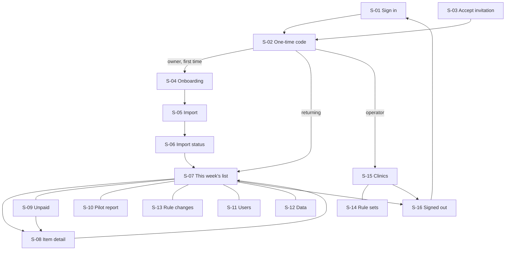

# App flow — ClaimCheck Rehab

Labels and sources: [Decision.md](Decision.md#how-numbers-are-labelled-used-in-all-ten-files). Routes, limits and timings here are author proposals `[P]`. Roles (`owner`, `staff`, `operator`) are defined in [PRD.md](PRD.md#6-buyer-users-and-roles); APIs in [TRD.md](TRD.md#api-contracts-proposed-apiv1-json-cookie-session-csrf-header-on-writes); tables in [schema.md](schema.md).

## 1. Screen inventory

| ID | Route | Screen | Roles | Must-haves |
|---|---|---|---|---|
| S-01 | `/sign-in`, `/reset` | Sign in, password reset | all | MH-10 |
| S-02 | `/mfa` | Enrol or enter one-time code | all | MH-10 |
| S-03 | `/invite/{token}` | Accept invitation | invitee | MH-10 |
| S-04 | `/onboarding` | Clinic set-up, data agreement, clinic key | owner | MH-01, MH-11 |
| S-05 | `/imports/new` | Import: choose, review, confirm | owner, staff | MH-01, MH-02 |
| S-06 | `/imports`, `/imports/{id}` | Import history and status | owner, staff | MH-02, MH-13 |
| S-07 | `/list` | This week's list | owner, staff | MH-03, MH-04, MH-05 |
| S-08 | `/items/{id}` | Item detail | owner, staff | MH-03, MH-07 |
| S-09 | `/unpaid` | Unpaid by payer and age | owner, staff | MH-06 |
| S-10 | `/pilot` | Pilot report and weekly minutes | owner (report), staff (minutes) | MH-08 |
| S-11 | `/settings/users` | Users | owner | MH-10 |
| S-12 | `/settings/data` | Data: export, delete, support access, activity | owner | MH-11, MH-13 |
| S-13 | `/rules` | Rule changes | owner, staff | MH-12 |
| S-14 | `/ops/rules` | Rule sets and export profiles | operator | MH-02, MH-12 |
| S-15 | `/ops/clinics` | Clinics: health and counts | operator | MH-09, MH-13 |
| S-16 | `/signed-out` | Signed out or session ended | all | MH-10 |

## 2. Navigation

## 3. Screens

### S-01 Sign in
- **Story:** as any user I sign in with email and password. **Entry:** no session. **Inputs:** email, password (paste and password managers allowed). **Visible:** product name, link to reset. **Actions:** sign in → S-02; "Forgot password" → `/reset` (email a single-use link; the same message whether or not the address exists).
- **States:** validation error (which field, in text); locked for 15 minutes after 10 failures, said plainly; network error with Retry.
- **Checks:** wrong password and unknown email give the same message; after an error, focus moves to the error summary.

### S-02 One-time code
- **Story:** I prove a second factor. **Entry:** password accepted. **Inputs:** 6-digit code (paste allowed), or a recovery code. First time: QR code and text secret to enrol, then 10 recovery codes shown once.
- **Actions:** verify → destination by role. **States:** wrong or reused code; expired step (5 minutes, with the remaining time shown and a "Start again" link that keeps the email address) returns to S-01 with a message.
- **Checks:** a code accepted once is refused the second time; no route beyond S-02 loads without a full session.

### S-03 Accept invitation
- **Story:** as a new staff member I set my password. **Entry:** valid, unused token under 72 hours old. **Inputs:** password twice. **Visible:** clinic name, role. **Destination:** S-02 enrolment.
- **States:** expired or used token → explanation and "ask your clinic owner for a new invitation".

### S-04 Onboarding
- **Story:** as owner I set the clinic up before any data moves. **Entry:** owner, clinic not yet active.
- **Steps:** (1) clinic name, location name as it appears in Jane, payers billed directly; (2) the data agreement summary — what is sent, what never is, where it is kept, how long — with the full text as a link; the owner ticks "I am authorized to agree for this clinic" and confirms; (3) create the clinic key: shown once with Copy and "I have saved it" confirmation; (4) map Jane staff names to disciplines (done in the browser; names are not sent).
- **Destination:** S-05. **States:** leaving mid-way keeps completed steps; step 3 cannot be skipped.
- **Checks:** no import endpoint accepts a batch for a clinic without a recorded agreement acceptance; the key never appears in a network request.

### S-05 Import
- **Story:** as staff I upload this week's exports and see exactly what leaves the clinic. **Entry:** agreement accepted; clinic key on this device (otherwise a prompt to enter it).
- **Step 1 Choose:** two file inputs (Sales export, Insurance Policies export) with a link to the two-minute Jane steps. The same two exports serve the free audit and every week; the Jane steps set the Sales date range to the last 365 days, because a "last 90 days" export misses older open invoices, including WorkSafeBC rejections still correctable (C1). Drag-and-drop is optional; the file buttons do the same.
- **Step 2 Review (nothing has been sent yet):** table of every column found: *Kept*, *Tokenised*, *Dropped*; counts of rows per payer; rows that cannot be read, with row numbers and reasons; rows whose claim state, billing code or service date the product will not be able to check, with counts; date range of the export.
- **Step 3 Confirm:** "Upload 1,184 rows" (synthetic). This is the external action: data leaves the clinic — exactly the 16 fields of [schema.md](schema.md#2-minimum-authorized-pilot-data), including the Jane invoice number in clear, to storage in Canada (AWS ca-central-1, proposed); the screen names them and says where they are kept (C1). The button states the row count and the review table stays visible above it.
- **States:** *unknown export shape* (required column missing): blocked, names the column, "Send header row to support" sends only the header names; *wrong location*: zero rows after filter, explained; *processing in browser*: progress with count; *uploading*: progress by batch, Cancel stops and discards; *duplicate*: "These files were already uploaded on 2 Nov" → link to that import; *offline mid-upload*: resumes when the same files are chosen again.
- **Destination:** S-06 for the new batch.
- **Checks:** with the network tab open, the request body holds only the 16 fields; pressing Confirm twice creates one batch.

### S-06 Import history and status
- **Story:** I see whether an import worked. **Visible:** list of batches (date, who, rows received / accepted / rejected / duplicate, status); for one batch, the rejected rows by row number and reason, and the rule evaluation status.
- **States:** *receiving*, *processing* (polled; status announced), *completed*, *completed with rejected rows* (partial success, amber, never shown as plain success), *failed* (Retry re-queues; rows are kept 24 hours), *rejected by guard* (nothing stored; what to do).
- **Actions:** open the list; download rejected rows as CSV (row number and reason only).
- **Checks:** received = accepted + rejected + duplicate on every batch; refreshing during processing returns to the same status.

### S-07 This week's list
- **Story:** as staff I work through the visits that need action, nearest deadline first. **Entry:** at least one completed import.
- **Visible:** banner with the date of the latest import and of the latest evaluation (warning if the import is over 8 days old); totals per class; a count line "could not check: N · no rules applied: N" that is always present; groups in this order: *Could not check* (first when not empty), *Deadline in 14 days or less*, *Can still be collected*, *Check before the next visit*, *Past payer deadline – payment at payer's discretion*, *Confirmed unpaid (payer outcome recorded)*, *Lost (payer rule)*, *Jane set-up* (C1: no row is called lost from a date alone); each row: Jane invoice number, payer, service date, rule in plain words, deadline, days left, amount, status.
- **Filters (in the URL):** payer, class, status, rule. **Actions:** open item; select rows and apply one outcome (up to 50); download CSV.
- **States:** *empty, no import yet* → S-05; *empty, nothing flagged and everything checked* → "Nothing needs action from the 1,013 visits checked. 0 could not be checked and 171 had no rules applied", each count a link; *nothing flagged but some not checked* → no such sentence: the could-not-check group and the banner "43 could not be checked. They are not fine." (fix round 1, B1-001: "nothing needs action" only when every row was checked with all applicable rules evaluated); *stale data banner*; *loading skeleton*; *evaluation running* notice.
- **Checks:** class totals equal the sum of rows; a `not_evaluated` finding is never shown as clear; an ICBC row that Jane shows as submitted still shows its 45-day limit; Back from S-08 restores filters and scroll position.

### S-08 Item detail
- **Story:** I see why this visit is flagged and record what I did. **Visible:** invoice number with "find this in Jane" hint; payer; dates; amounts; each rule result for the visit (`flag`, `clear`, `not_evaluated` with reason); the rule text, version, effective dates and source; the visit's state history across imports; item history.
- **Actions:** outcome — Submitted / Verified in ICBC's portal (received, or not received) / Payer declined (ICBC's outcome seen in its portal; makes the item "confirmed unpaid", C1) / Corrected and resubmitted / Treatment plan requested / Written off / Not an error (reason chosen from a list); Undo last outcome; Next item.
- **States:** *awaiting confirmation* (marked done, export not yet seen; for ICBC, until a payment or a portal verification is recorded); *reopened* ("marked submitted on 3 Nov; Jane's export of 10 Nov still shows Unsubmitted"); *conflict* (someone else changed it: shows their change, asks to re-apply); *permission denied or not found* → the same 404 page.
- **Checks:** an outcome cannot be saved for "Not an error" without a reason; no outcome form has a free-text box; a second save of the same outcome changes nothing.

### S-09 Unpaid by payer and age
- **Story:** as owner I see who owes what and for how long. **Visible:** table payer × age band (0–30, 31–45, 46–90, over 90 days) with counts and CAD; rows without rules labelled "no rules applied"; drill-down to rows → S-08.
- **States:** empty; stale banner as S-07. **Checks:** the grand total equals the unpaid total on S-07 plus the "no rules applied" rows.

### S-10 Pilot report
- **Story:** as owner I see the result the pilot is judged on; as staff I log the week's minutes. **Visible to owner:** M-01 to M-04 with inputs, exports supplied out of 13, items reopened after being marked done, the refund test and its current value. **Staff input:** minutes spent chasing this week (one number), minutes spent exporting.
- **States:** *not enough data yet* (before day 14) with what is missing; *audit only* (shows the look-back figures: rows in the 90-day window, older open rows, older WorkSafeBC rejections still correctable; each item says whether the export settles it or the payer's portal must confirm it, C1).
- **Checks:** every figure links to the rows behind it; the near-limit date cannot be changed by any user; missed-deadline escapes (M-09) are shown even when zero.

### S-11 Users
- **Story:** as owner I control who has access. **Actions:** invite by email and role; remove (confirmation names the person; ends their sessions); resend invitation. **Checks:** the last owner cannot be removed.

### S-12 Data
- **Story:** as owner I take my data out, delete it, and see activity. **Visible:** what is stored (row counts by table), retention dates, activity log, support access state.
- **Actions:** download all data (CSV); grant operator support access for 72 hours (shows exactly what the operator will see) and revoke; **delete all clinic data** — a review step lists row counts and what will remain (audit entries without values; backups for up to 35 days), then requires password and one-time code.
- **States:** *deletion pending*; *deleted* (account closed; confirmation with counts is emailed without row data).
- **Checks:** after deletion every clinic route returns 404 for former users.

### S-13 Rule changes
- **Story:** I can see which rules are applied and when they changed. **Visible:** each rule in plain words, payer source and date, effective range, date published, what changed.

### S-14 Rule sets and export profiles (operator)
- **Story:** as operator I publish a rule or profile version. **Inputs:** effective dates, parameters (days, counts, fees), source citation. **Actions:** run fixtures; **Publish** — a review step shows the diff, fixture results and how many clinics will be re-evaluated. **States:** fixtures failing → Publish disabled, with the reason beside it.

### S-15 Clinics (operator)
- **Story:** as operator I see whether each clinic is healthy without seeing its rows. **Visible:** clinic name, last import date, job failures, guard rejections, counts. Row access appears only where a support grant is live, with its expiry.

### S-16 Signed out
- **Story:** I know my session has ended. **Visible:** "You are signed out" or "Signed out after 30 minutes without activity"; Sign in. **Checks:** Back shows no clinic data (pages are served `no-store`).

## 4. Cross-screen behaviour

| Topic | Behaviour |
|---|---|
| Refresh | Every list state is in the URL; S-05 before Confirm holds files only in memory, so a refresh returns to step 1 with a note that nothing was sent; after Confirm the batch resumes from S-06 |
| Back and Forward | Never resubmit; S-05 Confirm and S-08 outcomes use idempotency keys, so a repeated request is a no-op |
| Deep links | `/items/{id}` and filtered `/list` links work after sign-in and return there; another clinic's link gives 404 |
| Duplicate submission | Import: same content hash returns the existing batch. Outcome: same item version and outcome is accepted once |
| Batch actions | Up to 50 items; result lists each item as done, skipped (already changed) or failed; nothing is reported as done unless it was |
| Reopening unfinished work | A half-finished onboarding, an import in `receiving`, and items "awaiting confirmation" each show a "Continue" entry at the top of S-07 |
| Session limits | Idle 30 minutes with a warning two minutes before; absolute 12 hours with a warning ten minutes before; in both cases work in progress is kept and restored after sign-in |
| Session expiry during work | The user is sent to S-16, then back to the same URL after sign-in; an unsent outcome is kept in the form |
| Sign-out | Server session ended, client state cleared, S-16 |
| Timeouts | Any request over 10 s shows "Still working" with Retry; import status is polled, not held open |

## 5. Irreversible or external actions and what is reviewed first

| Action | Reviewed before it happens |
|---|---|
| Upload rows (S-05) | Column table, row counts, date range |
| Delete clinic data (S-12) | Row counts, what remains, backup expiry; password and code |
| Remove a user (S-11) | Name, role, "their sessions end now" |
| Grant support access (S-12) | What the operator will see, expiry time |
| Publish a rule version (S-14) | Diff, fixtures, clinics affected |
| Write off an item (S-08) | Amount and rule; reversible, but counted in M-02 while it stands |

The product performs no action at ICBC, WorkSafeBC or Jane, so no payer-side action can be triggered from any screen.
