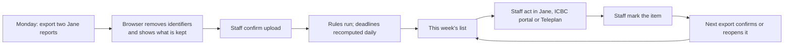

# PRD — ClaimCheck Rehab

Labels (`[C]`, `[S: SRC-nn]`, `[A]`, `[P]`, `[D]`) and sources are defined in [Decision.md](Decision.md#how-numbers-are-labelled-used-in-all-ten-files). Payer rules are cited as PR-nn from [Decision.md section 4.1](Decision.md#41-payer-rules-that-cause-non-payment-physiotherapy). Every target, threshold and day count in this file is a proposal `[P]` unless tagged otherwise.

## 1. Overview

ClaimCheck Rehab reads a BC physiotherapy clinic's weekly Jane billing exports, with patient identifiers removed in the clinic's browser, and returns one list: ICBC and WorkSafeBC visits that are about to become unpayable, are already unpayable, or are unpaid, each with the payer rule and the date that makes it so.

The repository exists to answer one question: **what can a BC clinic recover beyond Jane's existing rejection workflow?**

## 2. What the product does

1. Imports two Jane exports a week after dropping and tokenising identifiers before upload ([schema.md](schema.md#2-minimum-authorized-pilot-data)).
2. Applies a versioned, deterministic rule set built from the payers' own documents (rule catalogue in [TRD.md](TRD.md#deterministic-rules)).
3. Recomputes every deadline daily, because a visit moves toward its deadline whether or not a new file arrives.
4. Shows a weekly list and an unpaid list, each amount in one of three classes: permanent loss, delayed cash, administrative time ([Decision.md section 4.4](Decision.md#44-what-remains-for-claimcheck-rehab)).
5. Records what staff did with each item and checks it against the next export.
6. Measures the pilot result from the exports themselves.

It does not submit, correct or resubmit anything to a payer, and it does not write to Jane.

## 3. Why now

Both payers changed physiotherapy rules or fees in 2026 (PR-05, PR-09, PR-11) and two Jane guides had not caught up on 2026-11-10 ([Decision.md section 4.2](Decision.md#42-what-jane-already-provides)). ICBC added a visible 45-day warning in June 2025 `[S: SRC-14]` and now states the 45-day rule in the program guide (PR-01).

## 4. Goals

| ID | Goal | Measure |
|---|---|---|
| GOAL-1 | Show, per clinic, how much is recoverable beyond Jane's workflow | M-01 |
| GOAL-2 | Keep visits from crossing a payer deadline unnoticed, and never show a visit as fine when it was not checked | M-02, M-09 |
| GOAL-3 | Shorten the time money is outstanding | M-03 |
| GOAL-4 | Cut the minutes staff spend finding unpaid claims, net of export time | M-04 |
| GOAL-5 | Do all of this without patient names, birth dates or health numbers ever reaching the server | M-10 |

## 5. Problem statement

A clinic bills ICBC by re-keying each invoice into ICBC's portal and bills WorkSafeBC through Teleplan from Jane ([Decision.md section 4.2](Decision.md#42-what-jane-already-provides)). Jane shows the state of each invoice. Neither Jane (as documented) nor the payers show how many days each unsubmitted, rejected or unpaid invoice has left before PR-01, PR-07 or PR-08 closes, and ICBC's over-limit block (PR-03) arrives after the visit has been given. Whether this costs a typical clinic CAD 15 or CAD 680 a month is unknown.

## 6. Buyer, users and roles

| Role in the product | Person | Can do |
|---|---|---|
| `owner` | Clinic owner: buyer, budget owner, signs the data agreement | Everything `staff` can; invite and remove users; see the pilot report; export and delete clinic data; grant time-limited support access |
| `staff` | Front-desk or billing staff, clinic manager | Import, view lists, resolve and reopen items, log weekly minutes |
| `operator` | ClaimCheck Rehab staff (the founder) | Maintain rule sets and export profiles; see clinic names, import health and counts; **no access to a clinic's rows** unless an `owner` has granted support access, which expires after 72 hours |

One user belongs to one clinic location in the MVP. Patients, practitioners, ICBC and WorkSafeBC are not users.

## 7. Current and proposed workflows

**Current `[C]` + `[S: SRC-06]` `[S: SRC-03]`:** arrive the appointment in Jane → for ICBC, open the portal, re-key the invoice, mark Submitted in Jane, later record the payment by hand → for WorkSafeBC, submit through Teleplan; rejections appear in Jane's Rejected folder the next morning → once a month, build an unpaid-claims spreadsheet.

**Proposed:**

Before the application exists the founder performs steps B to E by hand ([execution-plan.md](execution-plan.md#phase-0--validation-by-hand-no-application)).

## 8. Non-goals

- Submitting, correcting or resubmitting invoices; any write to Jane, Teleplan, HCPIR or HCPP.
- Reading clinical records. The ICBC 20-minute minimum (PR-04 context) and report content cannot be checked from billing rows.
- Chiropractic, massage therapy, kinesiology, acupuncture and counselling rule sets. The chat's MVP listed ICBC "physio, chiro and RMT" and WorkSafeBC "physio and chiro" `[C]`; only the physiotherapy documents were read, so only physiotherapy ships. ICBC visits of other disciplines appear in the unpaid list with ageing only and are labelled "no rules applied", never "fine". WorkSafeBC kinesiologist and support-worker sessions billed under the physiotherapy fee schedule (19107, 19108) are in scope, because they count toward PR-09.
- Rules for extended health insurers. They appear in the unpaid list with ageing only (MH-06).
- Remittance PDF upload and AI reading `[C]`: deferred, because a remittance cannot be stripped of names before upload and Jane already holds the paid amounts ([TRD.md](TRD.md#ai-functions)).
- A Jane integration. Jane has no general public API `[C]`.
- Clinicmaster or Juvonno exports; Alberta or Ontario rules `[C]` ("scale").
- Benchmarks across clinics.

## 9. Must-haves

Priority: P0 = the pilot cannot run without it; P1 = needed before a second paying clinic. Screens are in [App-flow.md](App-flow.md); the full trace is in [verification-report-fixing.md](verification-report-fixing.md#3-traceability-of-must-haves).

| ID | Pri | User story | Observable acceptance criteria | Owner role |
|---|---|---|---|---|
| MH-01 | P0 | As staff, I upload Jane exports knowing identifiers never leave my computer. | (a) The browser lists every column as *kept*, *tokenised* or *dropped* before upload. (b) The request contains only the 16 allow-listed fields and two row ordinals. (c) A request carrying any other field, or a value that fails its type, pattern or plausibility check ([TRD.md](TRD.md#import-handling)), is rejected whole and nothing is stored. The check reduces the chance of an identifier being stored; it cannot prove there is none. (d) No raw file is sent or stored. | staff |
| MH-02 | P0 | As staff, I am told when Jane's export has changed shape instead of getting a wrong list. | (a) Headers are matched to a versioned export profile. (b) A missing required column blocks the import and names the column. (c) An unknown column is dropped and reported. (d) The user is never asked to type a missing date or amount. | staff |
| MH-03 | P0 | As an owner, I want every visit checked against every rule that applies to it. | (a) Each rule returns `flag`, `clear` or `not_evaluated` with a reason. (b) `not_evaluated` is shown, is never counted as clear, and never stops another rule on the same visit. (e) A visit whose state is unknown, whose service date is outside the loaded rule versions, whose billing code is unmapped, or whose discipline is outside the rule set is listed as "could not check" or "no rules applied" with a count on the list, and no screen or email describes it as fine. (c) Same input and rule version give the same output. (d) Each result stores the rule version and its source citation. | operator |
| MH-04 | P0 | As staff, I want the days-left figure to be right today, not on the day I uploaded. | (a) Deadlines are recomputed daily in America/Vancouver calendar days. (b) If the latest import is more than 8 days old the lists carry a banner giving its date. (c) An item that crosses a deadline changes class on that day. | operator |
| MH-05 | P0 | As staff, I get one weekly list ordered by the nearest deadline. | (a) Each row shows Jane invoice number, payer, date of service, rule in plain words, deadline, days left, amount and class. (b) Certain and discretionary permanent losses are separate groups. (c) Totals per class are shown and add up to the rows. (e) The words "nothing needs action" appear only together with the counts of visits that could not be checked and visits with no rules applied. (f) An ICBC invoice that Jane shows as submitted and unpaid keeps its 45-day limit on the row with "verify in ICBC's portal". (d) The list can be downloaded as CSV with the same columns. | staff |
| MH-06 | P1 | As an owner, I see what each payer owes and for how long. | (a) Amounts grouped by payer and by age band 0–30, 31–45, 46–90, over 90 days from date of service. (b) Extended-health and non-physiotherapy rows are included with ageing only and labelled "no rules applied". | owner |
| MH-07 | P0 | As staff, I record what I did with an item and can undo it. | (a) Outcomes: submitted, verified in ICBC's portal, corrected and resubmitted, treatment plan requested, written off, not an error (a reason chosen from a fixed list). (e) For ICBC, Jane's "Submitted" mark alone does not confirm an item: it is confirmed by a recorded payment or by the outcome "verified in ICBC's portal". (b) An item marked done stays visible as "awaiting confirmation" until an export shows the changed state. (c) If the next export still shows the old state, the item reopens with that message. (d) Any outcome can be reversed; history is kept. | staff |
| MH-08 | P0 | As an owner, I see the pilot result computed from my exports. | (a) M-01 to M-04 are shown with their inputs. (b) The date on which an item became *near-limit* is written once by the system and cannot be edited. (c) The report states how many of the 13 weekly exports were supplied. | owner |
| MH-09 | P1 | As staff, I get a Monday email telling me the list is ready. | (a) The email contains counts and a link only: no invoice number, claim token, amount per item or patient data. (b) It is sent once per clinic per week. (c) It says so when no export arrived that week. | staff |
| MH-10 | P0 | As an owner, only my clinic's users see my clinic's data. | (a) Password plus a time-based one-time code for every user. (b) Every query is scoped to the user's clinic in the database. (c) A request for another clinic's object returns 404 and is logged. (d) Removing a user ends their sessions at once. | owner |
| MH-11 | P0 | As an owner, I can take my data out and have it deleted. | (a) One action downloads all visit, claim and item rows as CSV. (b) Deletion completes within 7 days and returns row counts. (c) Audit-only clinics are deleted 30 days after the report. (d) Backups holding the data expire within 35 days. | owner |
| MH-12 | P0 | As operator, I change a rule when a payer changes it, without rewriting history. | (a) Rule versions carry an effective date range applied to the date of service. (b) Publishing needs a source citation and a passing fixture run. (c) Clinics see a dated rule-change log. (d) A visit whose date has no loaded fee version gets `not_evaluated`, not a guess. | operator |
| MH-13 | P1 | As an owner, I can see who did what. | (a) Imports, sign-ins, resolutions, exports, deletions, support grants and rule publications are recorded with user, time and correlation ID. (b) Records hold no row values. | owner |

## 10. Dependencies and constraints

| Kind | Item |
|---|---|
| Dependency | Jane keeps offering Excel or CSV export of the Sales and Insurance Policies reports `[S: SRC-08]` `[S: SRC-11]`; exact headers unknown until T-0.1.2. |
| Dependency | ICBC and WorkSafeBC keep publishing guides and fee schedules; someone reads each new edition (T-4.1.5). |
| Dependency | The clinic records ICBC payments and submission states in Jane promptly; where it does not, the product reports what Jane says. |
| Constraint | PIPA: use only for the clinic's billing purpose; reasonable security; destroy when no longer needed `[S: SRC-25]` ss. 18(2), 34, 35(2). |
| Constraint | Storage and processing in Canada `[C]`. |
| Constraint | One founder; Phase 0 cash cap CAD 5,500 ([Decision.md section 9.3](Decision.md#93-costs-kept-apart)). |
| Constraint | No build before the stop rule is read ([Decision.md section 11.3](Decision.md#113-proposed-revision-p--a-change-to-the-chats-rule-not-a-restatement)). |

## 11. Success metrics

**Definitions used by every metric.**

- **In-scope visit:** an invoice line whose payer is ICBC and whose discipline is physiotherapy, or whose payer is WorkSafeBC and whose billing code is in the physiotherapy fee schedule (PR-11), with a service date inside the loaded rule versions ([Decision.md section 4.1](Decision.md#41-payer-rules-that-cause-non-payment-physiotherapy)). Everything else is counted and labelled, and is in no total.
- **Look-back set:** visits with a date of service in the 90 days before the audit date `[C]`, **plus every older in-scope invoice still unsubmitted, rejected or unpaid** `[P]`. The addition is needed because PR-07 is itself 90 days: a 90-day window alone cannot contain a WorkSafeBC deadline miss.
- **Near-limit:** an item becomes near-limit on the first day it is still unsubmitted, or rejected and uncorrected, with 14 or fewer days left to its payer limit, or after the limit: an ICBC invoice unsubmitted 31 or more days after service (PR-01); a WorkSafeBC invoice unsubmitted 76 or more days after service (PR-07); a WorkSafeBC rejection within 14 days of its correction limit (PR-08). An ICBC invoice that Jane shows as submitted becomes near-limit only if staff record that ICBC's portal does not have it. The date is written once. **A clinic that invoices ICBC within 30 days and corrects rejections promptly has no near-limit items, so every measure built on this definition can be zero.** An earlier draft used "untouched for 14 days", which every flagged item met by construction (finding F-002).
- **Paid after flag:** an increase in the insurer-paid amount of a visit, seen in a later import.

| ID | Metric (kind) | Method and source | Denominator | Window | Baseline | Target `[P]` |
|---|---|---|---|---|---|---|
| M-01 | **Rescued near-limit cash**, CAD a month (pilot success; class: delayed cash and discretionary permanent loss) | Evidence rule: sum of *paid after flag* on items that had become near-limit, read from imports. Items acted on before they became near-limit are not counted here | 3 pilot months | Pilot days 1–90 | The look-back audit's count and CAD of near-limit items on the audit date (converted to a monthly figure for the build gate by dividing the 15-day band balance by 0.5, [Decision.md section 11.3](Decision.md#113-proposed-revision-p--a-change-to-the-chats-rule-not-a-restatement)). Still an upper bound on what the product caused: the clinic might have caught some anyway, and the report says so | ≥ 89 per clinic; the refund test is ≥ 267 over 90 days; both fail at zero near-limit items |
| M-02 | Permanent loss rate, ICBC (pilot success; class: permanent loss) | Evidence rule: CAD of in-scope ICBC visits in the cohort that passed PR-01 unsubmitted or fall under PR-03, certain and discretionary on separate lines. **WorkSafeBC cannot be measured as a rate in this window:** PR-07 needs 90 days and PR-08 at least 180, longer than either cohort. WorkSafeBC amounts found past PR-07 or PR-08 among older open invoices are reported as a balance beside the rate, with no before-and-after claim | CAD of in-scope ICBC visits in the cohort | Look-back cohort: service dates from audit date − 90 to audit date − 46. Pilot cohort: service dates on pilot days 1–45, read on day 91 | The look-back cohort's rate | Pilot rate below look-back rate; prevented loss = difference × pilot cohort CAD, reported as zero or negative when it is |
| M-03 | Delayed cash (pilot success; class: delayed cash) | Evidence rule: two balances read from one import each — (a) CAD unsubmitted more than 14 days after service plus CAD submitted and unpaid more than 30 days; (b) median days from service to first full payment, to the nearest weekly import | (b) paid in-scope visits | Audit date versus day 90 | Audit-date values | (a) lower at day 90; a balance, never converted to "recovered" |
| M-04 | Administrative time (pilot success; class: administrative time) | Evidence rule: minutes only. Baseline: staff time one normal week of checking unsubmitted, rejected and unpaid invoices on a paper sheet before the first list. Pilot: one figure entered weekly on S-10, plus timed export minutes | — | Weekly | Baseline week | Net minutes saved = baseline − (pilot chasing + export) > 0; may be negative and is reported so; never converted to dollars |
| M-05 | Audit-to-paid conversion (commercial) | Clinics paying a first CAD 89 invoice | Clinics audited | 30 days after each report | Assumed 25% `[C, assumption]` | ≥ 2 of 16 (stop rule) |
| M-06 | Weekly export compliance (commercial) | Imports received | 13 weeks | Pilot | — | ≥ 10 |
| M-07 | Flag precision (workflow quality) | Items closed "not an error" | Items closed | Pilot | — | ≤ 10% |
| M-08 | Not-evaluated share (workflow quality) | Findings `not_evaluated`, by rule and reason | All findings for that rule | Weekly | — | Reported; any rule above 50% is reviewed |
| M-09 | Missed-deadline escapes (failure; the measure of HCF-1) | Computed at each evaluation: visits that entered permanent loss, were present in an import at least 7 days before the limit, and had no open item or "could not check" entry in that time. Each escape raises an operator alert and appears on S-10 | — | Pilot | — | 0 |
| M-10 | Identifier guard rejections (failure) | Import requests refused under MH-01(c) | — | Weekly | — | 0 after onboarding; each one investigated |
| M-11 | Cross-clinic denials (failure) | Logged 404s under MH-10(c) | — | Weekly | — | Reviewed; a successful cross-clinic read is an incident |

## 12. Highest-consequence failure and highest-cost user mistake

**Highest-consequence failure (rank 1), named identically in [CLAUDE.md](CLAUDE.md) and [verification-report-fixing.md](verification-report-fixing.md):** **HCF-1 — a visit that is at risk, or was not checked, is shown as fine.** The product's only promise is that the list is complete. A false "fine" costs CAD 95–196 a visit (PR-05, PR-11), the clinic cannot bill the patient for it (PR-06), and the owner stops looking because the product said there was nothing to see. It ranks first because the harm is the exact thing the buyer paid to avoid and it is invisible when it happens. Known paths: an unrecognised claim state; an ICBC invoice marked Submitted in Jane but never keyed into ICBC's portal; a service date or billing code outside the loaded rules; a WorkSafeBC support session left out of a visit count; rows dropped in an import; an evaluation that did not run. Prevention, detection and recovery: MH-03(b, e), MH-04, MH-05(e, f), MH-07(e), M-09, [TRD.md](TRD.md#highest-consequence-failure-hcf-1).

Rank 2: **HCF-2 — identifiable patient data leaves the clinic or reaches another clinic.** Either a patient name, birth date or health number is stored outside the clinic, or one clinic's rows are shown to another. It cannot be undone, it falls on patients who never chose the product, and the clinic carries the legal responsibility `[S: SRC-25]` s. 4(2). It is ranked second, not first, because the data is reduced to 16 billing fields before it leaves the clinic, which limits the harm; it is still treated as an incident every time. Prevention and recovery: MH-01, MH-10, [TRD.md](TRD.md#second-ranked-failure-hcf-2), and for the hand-run phase the [Phase 0 data procedure](execution-plan.md#phase-0-data-procedure).

**Highest-cost user mistake:** staff mark an ICBC item "submitted" in ClaimCheck Rehab without completing the invoice in ICBC's portal. The item leaves the active list and the 45-day deadline passes. **Who reviews it:** the next import (MH-07 b, c, e) — the item stays "awaiting confirmation" with its 45-day limit still showing, reopens if Jane still shows it unsubmitted, and is not confirmed by Jane's "Submitted" mark alone; the owner sees the count of reopened items on S-10. **How it is corrected:** staff submit the invoice and the following export confirms it; if the deadline has passed, the item moves to discretionary permanent loss and the owner decides whether to submit late or write off.

## 13. Evidence that would justify expanding the MVP

| Evidence | Expansion |
|---|---|
| The single build gate in [Decision.md section 11.3](Decision.md#113-proposed-revision-p--a-change-to-the-chats-rule-not-a-restatement) is passed | Build as specified. This table adds no second gate |
| After 90 pilot days, M-01 is at least CAD 150 a month at the median of the pilot clinics | Keep the price; below that, re-price or stop selling before adding anything |
| Three or more pilot clinics ask for chiropractic or massage therapy, and the guides have been read | Add those rule sets |
| Staff report that payment status is the missing piece and Jane's paid amounts lag by more than two weeks | Revisit remittance reading |
| M-08 shows a rule mostly `not_evaluated` for a missing date | Ask Jane for the field or drop the rule |
