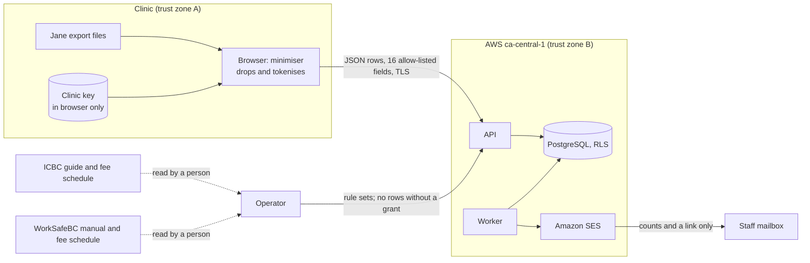
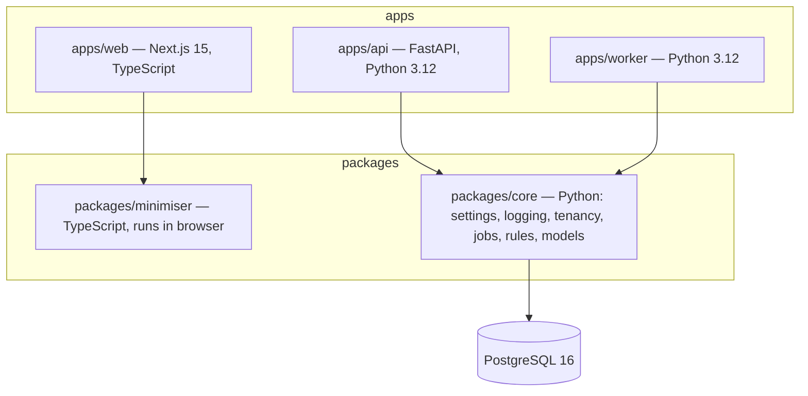
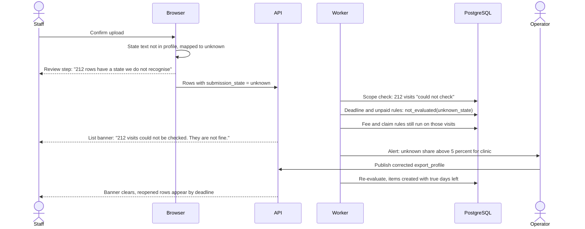
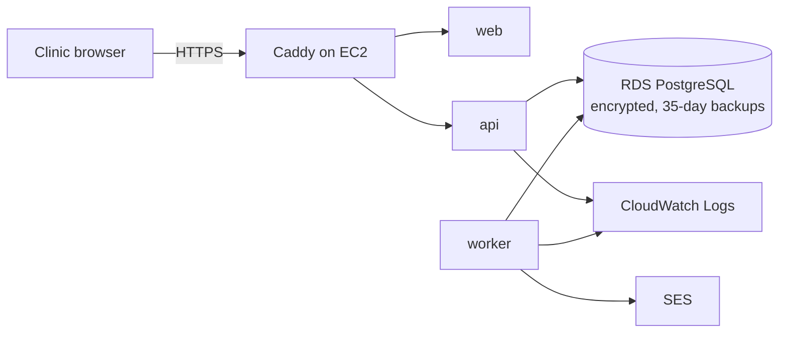

# TRD — ClaimCheck Rehab

Arc42 order. Labels and sources: [Decision.md](Decision.md#how-numbers-are-labelled-used-in-all-ten-files). Every stack choice, limit, timeout, target and cost in this file is an author proposal `[P]` unless tagged otherwise. Nothing here is built; every command is **proposed**. Requirements are MH-nn in [PRD.md](PRD.md#9-must-haves); risks are R-nn in [verification-report-fixing.md](verification-report-fixing.md#production-risk-register).

## 1. Introduction and goals

Turn two weekly Jane exports into a dated list of ICBC and WorkSafeBC physiotherapy visits at risk, without identifiable patient data reaching the server. Top quality goals, in order: (1) completeness and correctness — no visit that is at risk or unchecked is ever shown as fine (HCF-1); (2) confidentiality and clinic isolation (HCF-2); (3) recoverability of an interrupted import; (4) operability by one person.

## 2. Constraints

| Constraint | Source |
|---|---|
| Clinic data stored and processed in Canada | `[C]` |
| Use only for the clinic's billing purpose; reasonable security; destroy when not needed | `[S: SRC-25]` ss. 18(2), 34, 35(2) |
| No Jane API; input is Excel or CSV exported by staff | `[C]` `[S: SRC-11]` |
| Dates, money, access and eligibility are deterministic code | SPEC; AD-04 |
| 1–3 developers; fixed cost assumption CAD 700 a month | `[C, assumption]` |
| No write to any payer or to Jane | [PRD.md](PRD.md#8-non-goals) |

## 3. Context and scope



External systems: Jane (source of files, no connection); ICBC HCPIR/HCPP and Teleplan (where staff act, no connection); Amazon SES (outbound email); Stripe (subscription invoices, outside the application, never sees clinic rows).

## 4. Solution strategy

| Decision | Choice | Main tradeoff |
|---|---|---|
| Where identifiers are removed | In the browser, before upload (AD-01) | More front-end code and a clinic-held key, in exchange for a server that holds no names, birth dates, health numbers or reversible claim numbers |
| Rule engine | Python functions over typed rows, versioned by effective date (AD-04) | Rules are code and need a release to change, in exchange for testability |
| Jobs | PostgreSQL table with `FOR UPDATE SKIP LOCKED`, one worker process (AD-05) | No Redis to run or secure; throughput limit is far above need |
| Files | None stored (AD-02) | The clinic must keep its own exports if it wants to re-run history |
| AI | None in the pilot (AD-06) | The chat's remittance reading is deferred |

## 5. Building block view



`apps/api` and `apps/worker` import only the public interface of `packages/core`; neither imports the other (R-04, R-06, R-07). `packages/core.logging` has no web-framework import (R-07).

| Layer | Choice |
|---|---|
| Frontend | Next.js 15 (React, TypeScript), server-rendered shell, client components for import and lists |
| Backend | FastAPI, Pydantic v2, SQLAlchemy 2, Alembic |
| Database | PostgreSQL 16 on Amazon RDS, row-level security |
| Storage | None for clinic files. No object store in the MVP |
| Integration | Amazon SES (ca-central-1) for email. No payer or Jane integration |
| Testing | pytest, Hypothesis for date rules, Vitest for the minimiser, Playwright with axe for end-to-end and accessibility |
| Hosting | One EC2 instance (Docker Compose: web, api, worker, Caddy for TLS) and one RDS instance, both ca-central-1 |
| DevOps | GitHub Actions: lint, type-check, tests, migration checks, image build; deploy by image tag |

### Identity and tenancy

- Sign-in: email address as identifier, password (minimum 8, 15 recommended, checked against a common-password list), then a time-based one-time code. Email is never an authentication factor; it carries invitations and reset links only, and a reset does not bypass the second factor.
- Lost second factor: ten single-use recovery codes are issued at enrolment. A staff member without codes is removed and re-invited by the clinic owner, who vouched for them at enrolment. An owner without codes is re-enrolled by the operator only after a call back to the clinic's published telephone number, a 24-hour delay, and a notice to every user of the clinic; the reset sends a new invitation and gives the operator no access to rows. This is the planned answer to ASVS 6.4.4; it is not verified.
- Sessions: opaque reference token, 128 bits from a CSPRNG, in an `HttpOnly; Secure; SameSite=Lax` cookie; stored hashed in `session`; idle timeout 30 minutes, absolute 12 hours; rotated at sign-in; all sessions of a user ended on removal or factor change.
- Tenant = clinic location. Every clinic-owned table carries `clinic_id`. The API opens each request transaction with `SET LOCAL app.clinic_id`; RLS policies compare it; the application database role has no `BYPASSRLS`. The worker sets the same variable from `job.clinic_id` before touching rows. There is one tenancy module in `packages/core` and no other place that builds a clinic filter (R-05).
- Operator requests run under a second database role that can read `clinic`, `import_batch` counts, `job`, `rule_*`, `export_profile` and `audit_event`, and nothing else, unless a live `support_grant` exists for that clinic.
- No cache and no file store exist in the MVP, so there is no second place to enforce tenancy.

### Import handling

1. The browser parses the two files with `packages/minimiser`, matches headers to an `export_profile`, keeps 16 fields, tokenises the claim number with HMAC-SHA-256 under the clinic key (truncated to 128 bits), maps practitioner to discipline, filters to the clinic's location, and shows the kept / tokenised / dropped table.
2. On confirm: `POST /imports` (idempotency key = SHA-256 of the minimised content) → `POST /imports/{id}/rows` in batches of 500 with row numbers → `POST /imports/{id}/finalize` with the expected count.
3. The server validates every row against a strict schema and then runs plausibility checks on the whole batch. Schema: unknown key → reject the request; `invoice_ref` must match the invoice-number format recorded in the export profile from T-0.1.2 (until that is known the pattern is `^[A-Za-z0-9-]{1,20}$`, which is too loose to rely on); `billing_code` must be a code mapped in the profile, anything else having been replaced by `UNMAPPED` in the browser; tokens `^[0-9a-f]{32}$`; dates ISO; amounts decimal from 0 to 2,000; enumerations closed. Plausibility, any failure rejecting the batch: (i) no `invoice_ref` is a 10-digit number that passes the BC personal health number check digit (the algorithm is to be taken from the Ministry of Health's specification in T-1.1.4, not from memory `[A]`); (ii) no `invoice_ref` is made of letters only; (iii) at least half of the `invoice_ref` values among the visit rows are distinct, because a column of patient numbers or names repeats far more than a column of invoice numbers; (iv) `date_of_service` is within the last three years and not in the future, `date_of_event` within the last ten years, and no date is earlier than 2015. Item reasons are chosen from a fixed list, so no stored field is free text. A rejected request stores nothing and writes an audit event without values.

   **B1 interim for check (i), revised in fix round 1 (B1-006):** the Ministry of Health check-digit specification (T-1.1.4) was not available, so the implemented guard rejects every `invoice_ref` that, with hyphens removed, contains a run of ten or more digits ("9123-456-782", "P9123456782" included). This is stricter than the specified check for every value the contract pattern admits and would also refuse a genuine Jane invoice number with ten or more digits; T-0.1.2 and T-1.1.4 replace it. **Check (ii) widened (B1-005):** an `invoice_ref` whose digits are fewer than half of its letters and digits is refused as name-shaped, which catches one-word, hyphenated and multi-part surnames and a name with a digit appended ("Zelda2"). Residual risk, stated: a mostly-numeric identifier other than a health number (a patient-number column) still passes. **Browser (B1-005):** the minimiser blocks the import when any row has more or fewer fields than its header, naming the file rows, so a stray comma cannot shift a name into `invoice_ref` or a visit into "other location".

   **What the guard does and does not do.** It catches a shifted column of health numbers, one-word surnames, patient numbers or adult birth dates. It **cannot prove that a value is not an identifier**: a patient-number column with few repeats in a small file, or a child's birth date in a date field, would pass. An earlier draft said a name or health number "cannot fit any field"; that was wrong and is withdrawn (finding F-005). The residual risk is stated in the data agreement, and a daily `identifier_scan` job re-runs checks (i) to (iv) over each clinic's stored rows and alerts the operator.
4. Finalize is a job. It checks the count, upserts `claim` and `visit`, appends `visit_snapshot` for changed rows, records accepted / rejected / duplicate counts that must add up to the received count (R-19), and queues evaluation.

Clinic key: generated in the owner's browser at onboarding, shown once as a 32-character recovery string for the owner's password manager, entered once per staff device and held as a non-extractable WebCrypto key in IndexedDB. The server never receives it. If it is lost, a new key is created and a re-key import replaces claim tokens by matching visits on `invoice_ref`.

### API contracts (proposed, `/api/v1`, JSON, cookie session, CSRF header on writes)

| Method and path | Role | Purpose | Notes |
|---|---|---|---|
| POST `/auth/sign-in`, `/auth/mfa`, `/auth/sign-out` | any | Session | Rate-limited per account and IP |
| POST `/auth/reset-request`, `/auth/reset` | any | Password reset | Same response whether or not the email exists |
| POST `/invites`; POST `/invites/{token}/accept` | owner; invitee | Users | Token single-use, 72 hours |
| GET, PATCH `/clinic` | owner | Profile, payers, location filter | |
| POST `/agreement-acceptances` | owner | Record data-agreement version accepted | |
| POST `/imports` | staff | Create batch | Idempotency key required; same key returns the existing batch |
| POST `/imports/{id}/rows` | staff | Row batch | Idempotent on (batch, row number); 422 on guard failure |
| POST `/imports/{id}/finalize` | staff | Start processing | 202; safe to repeat |
| GET `/imports`, `/imports/{id}` | staff | History, status, rejected rows | Poll every 3 s while `processing` |
| GET `/items?view=week\|unpaid&class=&payer=&cursor=` | staff | Lists | Filters live in the URL |
| GET `/items/{id}` | staff | Detail with findings and history | 404 for another clinic |
| POST `/items/{id}/events` | staff | Resolve, reopen, dismiss | `If-Match` version; 409 on stale |
| POST `/items/bulk-events` | staff | Same outcome for up to 50 items | Per-item result returned |
| GET `/items/export.csv` | staff | Streamed CSV | Not stored. Any cell beginning with `=`, `+`, `-` or `@` is prefixed with an apostrophe so a spreadsheet does not run it as a formula |
| GET `/pilot-report`; POST `/time-logs` | owner; staff | Measurement | |
| GET `/rule-changes` | staff | Published rule versions | |
| GET, POST `/users`; DELETE `/users/{id}` | owner | Users | |
| GET `/data-export.csv`; POST `/deletion-requests` | owner | Take out and delete | Deletion needs password and code again |
| POST, DELETE `/support-grants` | owner | Operator access for 72 hours | |
| GET, POST `/ops/rule-versions`; POST `/ops/rule-versions/{id}/publish` | operator | Rule sets | Publish refused unless fixtures pass |
| GET `/ops/clinics` | operator | Health and counts | No rows |
| GET `/healthz`, `/readyz` | none | Liveness, readiness | Readiness checks database and migration head |

Errors use one shape: `{code, message, correlation_id, fields?}`.

### Configuration and secrets

One typed settings module in `packages/core`, read from environment variables and validated at start; the API and worker fail to start on a missing or malformed value. Secrets (database URL, session pepper, SES credentials) live in AWS Systems Manager Parameter Store, ca-central-1. No secret is in the repository or in an image. `PUBLIC_BASE_URL` is the only source for links in email (R-16).

### Jobs, retries, timeouts, idempotency

| Job | Trigger | Idempotency key | Timeout | Retries | On final failure |
|---|---|---|---|---|---|
| `import_finalize` | API | batch id | 120 s | 3, backoff 30 s / 2 min / 10 min | Batch `failed`, rows kept in staging 24 h, staff told to retry |
| `evaluate_clinic` | After import; daily 05:00 Pacific | clinic id + local date + rule-set version | 120 s | 3 | Lists show "last evaluated" date banner; operator alert |
| `weekly_email` | Monday 07:00 Pacific | clinic id + ISO week | 30 s | 5 | Operator alert; list still available |
| `retention_purge` | Daily | local date | 300 s | 3 | Operator alert |
| `identifier_scan` | Daily | clinic id + local date | 120 s | 3 | Operator alert; imports for the clinic paused until reviewed |
| `deletion_execute` | Owner request | request id | 300 s | 3 | Operator alert; request stays `pending` |

Since fix round 1 (B1-008) the worker connects as its own role; since round 2 the queue functions are owned by `claimcheck_queue_owner` (NOLOGIN, NOSUPERUSER, NOBYPASSRLS; reaches `job` and `clinic` only through policies granted to it; search_path `pg_catalog, public, pg_temp`), the same locally and in production. The worker connects as `claimcheck_worker` (NOSUPERUSER, NOBYPASSRLS), the only role that may execute the cross-clinic queue functions; the API role can enqueue for its own clinic (RLS) and nothing else. State changes are guarded: a worker claims a job with a lease token and may only write `succeeded` or `failed` where `status = 'running' AND lease_token = :mine`; a late or duplicate completion updates zero rows and is logged (R-01). The API never waits for a job: it returns 202 and the client polls, so a caller timeout cannot hide a later completion (R-02). Evaluation writes findings for a (visit, rule) pair by upsert, so a repeat produces no duplicates.

### Deterministic rules

All dates are calendar days in America/Vancouver. "Submit by" is one day earlier than the payer's limit `[P]`, because neither source says whether the last day counts; the screen shows both. Fee versions apply by date of service; a date with no loaded version gives `not_evaluated`. Each rule returns `flag`, `clear` or `not_evaluated(reason)` independently of every other rule (MH-03).

**Scope and state come before any rule.** Each visit is first put in exactly one of three groups. *In scope:* ICBC with discipline physiotherapy, or WorkSafeBC with a code in PR-11, a recognised state, and a service date inside a loaded version of the rule. *Could not check:* state `unknown`; service date outside every loaded version (`no_rule_version`); billing code `UNMAPPED`. *No rules applied:* ICBC visits of another discipline, other payers. **Only an in-scope visit can produce `clear`.** For a visit that could not be checked, every deadline and unpaid rule returns `not_evaluated` with the reason, and the visit is listed and counted on the list, the unpaid view and the Monday email. Every rule version, not only fees, carries an effective range ([Decision.md section 4.1](Decision.md#41-payer-rules-that-cause-non-payment-physiotherapy)).

**Fix round 1 (2026-11-11): four groups, and every row accounted for.** (a) *Could not check* now also covers payer wording the profile does not recognise (`UNKNOWN` payer, B1-007; the profile lists the known other insurers, and anything else is never `OTHER`) and an ICBC code that has no fee in the version for its date (Hand Therapy before 2026-09-27 is `no_rule_version` at scope, B1-002). (b) A fourth group, *rules not evaluated*: an in-scope visit for which any applicable rule, its own or its claim's, returned `not_evaluated` is never counted as checked or clear; it is listed with each `RULE:reason` (B1-002). (c) Rows refused at finalize (a required field the browser could not read; conflicting rows for one invoice line, none of which is kept) stay on the list as "could not check" with a `row:<reason>` until a later export completes; exact repeats are counted. On the week list, visit rows + claim rows of the latest export add up to the rows received (B1-001). (d) "Nothing needs action" is said only when every row was read, every visit was checked with all applicable rules evaluated, and no item is open; otherwise the sentence is withheld and the banner gives the number that could not be checked (coordinator ruling on B1-001).

| Rule | Payer rule | Flags when | Inputs that may be missing → `not_evaluated` | Class |
|---|---|---|---|---|
| ICBC-01 | PR-01 | Unsubmitted and 14 or more days since service; limit service date + 45, submit by + 44; near-limit from day 31 | State `unknown`; no rule version for the date; Jane shows submitted with no payment and no "verified in ICBC's portal" outcome (`jane_submitted_unverified`: Jane's mark is not proof, so ICBC-01 never reads `clear` on it; ICBC-07 carries the limit) — B1 clarification. Fix round 1 (2026-11-11) (B1-004): ICBC `rejected` gives `not_evaluated(icbc_rejected_no_rule)` (no ICBC correction rule has been read); `partly_paid` is clear here because a payment proves ICBC has the invoice, and ICBC-07 carries the balance | Delayed cash; discretionary permanent loss after the limit |
| ICBC-02 | PR-02 | Treatment count on the claim exceeds 25, or reaches 22 with a next appointment, and Jane's policy maximum has not been raised | Treatment count | Certain permanent loss / warning |
| ICBC-03 | PR-02, PR-03 | Service date or next appointment is after crash date + 84 days, or after the policy end date, with no later end date recorded | Crash date and end date both absent | Certain permanent loss / warning |
| ICBC-04 | PR-04 | A second Initial Visit on one claim, or a Standard Treatment on the Initial Visit date | No claim link | Check with ICBC (no amount): ICBC may have approved a second Initial Visit |
| ICBC-05 | PR-04 | Two physiotherapy sessions on one claim on one day | No claim link | Check with ICBC (no amount): a standard and a non-standard session on one day can be paid if one is invoiced manually |
| ICBC-06 | PR-05 | The Jane billing-code amount differs from the schedule for that service date (base fees from 2026-04-01; Hand Therapy 97 / 110 / 145 from 2026-09-27) | No fee version for the date; unmapped billing code | Administrative time ("Jane set-up"): Jane's price list does not set what ICBC pays. Certain permanent loss only where a **paid** amount on a paid invoice is below the schedule |
| ICBC-07 | Gap G-4 | Jane shows submitted, no payment recorded, 14 or more days since service: "verify in ICBC's portal". The row keeps the PR-01 limit and days left, because Jane's mark is manual and nothing contradicts it. From 30 days after the state date (or service date): "chase payment". If staff record that the portal does not have the invoice, it is treated as unsubmitted and ICBC-01 applies | State `unknown`; `rejected` (`icbc_rejected_no_rule`). Fix round 1 (2026-11-11) (B1-004): `partly_paid` with a balance flags "partly paid balance", delayed cash, at once | Delayed cash |
| ICBC-08 | Gap G-3 | ICBC policy in Jane has no maximum or no end date, so Jane cannot alert | — | Administrative time |
| WSBC-01 | PR-07 | Unsubmitted and 14 or more days since service; limit + 90, submit by + 89; near-limit from day 76 | State `unknown`; no rule version | Delayed cash; discretionary permanent loss after the limit |
| WSBC-02 | PR-08 | Rejected; limit = later of service date + 180 and first rejection + 90. Fix round 1 (2026-11-11) (B1-003): the shown limit is the **earliest possible** limit and can only be earlier than the true one: weekly exports cannot reveal the true first rejection (it may predate the first export, and Jane's state date moves on re-rejection), so first rejection is replaced by the export date of the last snapshot in the visit's initial run of `unsubmitted` observations (before which it cannot have been rejected); a visit first seen in any other state gets service + 180 (the re-rejection case: service 2026-05-01 gives 2026-10-28). Fixed after retest (round 2, 2026-11-11), B1-010: the rule carries both bounds. Earliest possible limit = as above, shown as "act by" so the clinic is never late; latest possible limit = later of service + 180 and (the first export date showing `rejected`, or its state date if earlier) + 90. Up to the earliest: delayed cash, near-limit in its last 14 days. Between the two: "at risk, may still be collectable: check the first rejection date in Teleplan" (delayed cash, near-limit, never written off, never in "lost"). Only after the latest: certain permanent loss. Without a latest bound the loss is never called certain. The backlog case (service 2026-05-01, first seen rejected, state date 2026-09-10): act by 2026-10-28, certain only after 2026-12-09. If the first rejection date is unknown the limit is service date + 180, the earliest value the rule allows; near-limit in the last 14 days | State `unknown`; no rule version | Delayed cash; certain permanent loss after the limit |
| WSBC-03 | PR-12 | No claim number on a WorkSafeBC line | — | Delayed cash |
| WSBC-04 | PR-09 | Two visits on one claim on one day, counting 19102, 19107 and 19108 whoever delivered them | No claim link | Certain permanent loss |
| WSBC-05 | PR-10 | 19102 with 19100 or 19101 on the same claim and day | — | Delayed cash |
| WSBC-06 | PR-10 | 19100 more than 60 days after the date of injury | Date of injury | Warning: needs officer approval |
| WSBC-07 | PR-09 | More than 10 treatment visits (19102, 19107 and 19108 together), or a visit more than five calendar weeks after the first treatment visit, with no raised maximum or end date in Jane | Treatment count; no claim link | Warning: confirm extension |
| WSBC-08 | PR-11 | The Jane billing-code amount differs from the schedule for that service date | No fee version; unmapped code | As ICBC-06 |
| WSBC-09 | PR-11 | Claim closed, or no visit for 14 days and no next appointment, and no 19105 line | Policy status and next appointment both absent | Delayed cash (CAD 45, if the report was sent) |
| WSBC-10 | Gap G-4 | Submitted, unpaid, 30 or more days | State `unknown`. Fix round 1 (2026-11-11) (B1-004): `partly_paid` with a balance flags "partly paid balance", delayed cash, at once | Delayed cash |

Claim-level rules (ICBC-02, ICBC-08, WSBC-07, WSBC-09) are evaluated once per claim with the version in force on the latest service date among the claim's checked visits; a claim whose visits all could not be checked cannot read `clear` (B1). For ICBC-03 a recorded end date is taken as the approved period; without one the period ends on crash date + 84 days (B1 reading of the row above).

A raised policy maximum or later end date in Jane is taken as the clinic's record that the payer approved more treatment; the product cannot see the approval itself and says so on the item.

### AI functions

**None in the pilot build (AD-06).** The chat proposed a small model to read remittance PDFs and to turn payer bulletins into rule updates `[C]`. Both are deferred:

| Aspect | If remittance reading is added later |
|---|---|
| Responsibility | Extract invoice reference, paid amount, date and explanation code from a remittance; nothing else |
| Human-review boundary | Every extracted line is shown beside the source line and confirmed by staff before it changes an item |
| Evaluation fixtures | At least 30 synthetic remittances per payer layout with known answers; release blocked under 99% field accuracy `[P]` |
| Fallback | Manual entry of the same four fields; the lists work without it |
| Provider or model change | Version pinned; fixtures re-run before any switch; result stored with model version |
| Deterministic regardless | Matching to visits, date arithmetic, class and amounts |
| Privacy precondition | A way to remove names before upload, or a new, wider data agreement |

Payer bulletins are read by a person (T-4.1.5). A rule change is code plus fixtures.

## 6. Runtime view

### Normal sequence: weekly import to list

```mermaid
sequenceDiagram
  actor S as Staff
  participant B as Browser (minimiser)
  participant A as API
  participant D as PostgreSQL
  participant W as Worker
  S->>B: Choose two Jane files
  B->>B: Match export profile, drop, tokenise
  B-->>S: Show kept / tokenised / dropped
  S->>B: Confirm
  B->>A: POST /imports (idempotency key)
  A->>D: insert import_batch (received)
  loop batches of 500
    B->>A: POST /imports/{id}/rows
    A->>A: strict schema guard
    A->>D: upsert import_row
  end
  B->>A: POST /imports/{id}/finalize
  A->>D: enqueue import_finalize
  A-->>B: 202
  W->>D: claim job; upsert claim, visit, visit_snapshot
  W->>D: enqueue evaluate_clinic
  W->>D: findings and items upserted
  B->>A: GET /imports/{id} (poll)
  A-->>B: completed: accepted, rejected, duplicate counts
  S->>B: Open this week's list
```

### Highest-consequence failure: HCF-1

**A visit that is at risk, or was not checked, is shown as fine.** Scenario: Jane renames a claim state ("Submitted" becomes "Sent") and the export profile no longer recognises it; 212 ICBC invoices arrive with a state the product cannot read.



Other paths to the same failure and what stops each:

| Path | Control | Test |
|---|---|---|
| Unknown state, service date outside loaded rules, unmapped code | Scope check before rules; "could not check" rows and counts; never `clear` | UT-16, E2E-09 |
| ICBC invoice marked Submitted in Jane, never keyed in the portal | ICBC-07 keeps the 45-day limit on the row and asks for portal verification; Jane's mark does not confirm an item | UT-17, IT-08 |
| WorkSafeBC support session left out of a count | WSBC-04 and WSBC-07 count 19102, 19107 and 19108 | UT-18 |
| Rows lost in an import | Counts must add up; rejected rows listed | IT-03 |
| Evaluation did not run, or the export is old | "Last checked" date; banner after 8 days without an import | IT-16 |
| Rule or fee version missing or wrong | Effective ranges; `not_evaluated(no_rule_version)`; fixtures before publication | UT-07, UT-19 |
| The product itself missed one | M-09 computed at every evaluation; operator alert | IT-17 |

**Recovery when an escape is found (M-09 above zero):** the operator tells the clinic within one working day, inside the application, which invoices were missed and what can still be done (submit late to ICBC, whose payment is discretionary; a late-submission reason for WorkSafeBC; a correction inside the PR-08 window); the escape is shown on the pilot report and is never netted against M-01; a fixture reproducing it is added before the fix ships. In Phase 0 the same applies to the hand-run list: a second-pass check of 10% of rows (T-0.3.2) and a weekly comparison of last week's list with this week's export (T-0.4.2).

### Second-ranked failure: HCF-2

**Identifiable patient data leaves the clinic or reaches another clinic.** Scenario: Jane changes its export so that a patient-name column sits where the invoice number was, and the browser's profile match does not catch it.

```mermaid
sequenceDiagram
  actor S as Staff
  participant B as Browser
  participant A as API
  participant D as PostgreSQL
  actor O as Operator
  S->>B: Confirm upload
  B->>A: POST /imports/{id}/rows
  A->>A: invoice_ref fails format or plausibility check
  A-->>B: 422 identifier_guard (no values echoed)
  A->>D: batch = rejected_guard; audit_event (no values)
  Note over A,D: Nothing from the request is stored
  B-->>S: "Nothing was uploaded. Jane's export looks different."
  A->>O: Alert: guard rejection for clinic
  O->>A: Publish corrected export_profile after checking header-only file
  S->>B: Retry with the same files
```

If identifiers are later found **already stored** (a guard gap, found by `identifier_scan` or by a person): the operator suspends imports for the clinic, runs `deletion_execute` for the affected batch and its derived rows, records the purge in `deletion_request` so that it is replayed after any restore, tells the owner within 24 hours what was stored and for how long, and adds a fixture that reproduces the gap. PIPA as read has no mandatory breach-notification section `[S: SRC-25]`; whether patients are told is the clinic's decision and the agreement obliges the operator to supply the facts. Copies in backups age out within 35 days; this is stated to the owner and is not described as immediate deletion.

Cross-clinic branch: a request for another clinic's item passes the API check by mistake → RLS returns no row → 404 → audit event → operator alert.

### Other recovery paths

| Failure | Behaviour |
|---|---|
| Browser closed mid-upload | Batch stays `receiving`; re-selecting the same files resumes by row number; batches older than 24 h are purged |
| Finalize job crashes | Lease expires after the timeout; retried; upserts make the repeat safe |
| Second import while one is processing | Queued per clinic; processed in order of the export's own date |
| Older export uploaded after a newer one | Accepted for history; `visit` current state is not overwritten by an older snapshot (R-01) |
| Email provider down | Retried; list unaffected |
| Rule publication found wrong | Unpublish = publish previous version; re-evaluation restores prior findings; item history keeps both |

## 7. Deployment view



| | Local | Staging | Production |
|---|---|---|---|
| Data | Synthetic fixtures only | Synthetic only | Clinic data |
| Database | PostgreSQL in Compose with a named volume | RDS, small | RDS, encrypted, deletion protection, point-in-time recovery |
| Email | Captured by a local mail catcher | SES sandbox | SES |
| Start | `make dev` (proposed): database, migrations, API, worker, web, each with a health check | Deploy by tag | Deploy by tag after staging passes |

- **Deployment (proposed):** `make deploy TAG=…` pulls images, runs `alembic upgrade head` as a separate step, then restarts api, worker and web; readiness must pass before Caddy switches.
- **Rollback:** redeploy the previous tag. Migrations are expand-then-contract, so the previous tag runs against the new schema; a contract migration ships only after one release without rollback.
- **Backup and restore:** RDS automated backups, 35 days; restore to a new instance, replay completed `deletion_request` rows newer than the backup, verify counts, then switch. Drill before the first clinic (T-6.1.1).
- **State outside the database:** none. Containers are stateless; no volume is needed in staging or production (R-15).
- **Alerts:** one owner, the operator, by email and SMS: API 5xx rate, job failed or older than 15 minutes, guard rejection, `identifier_scan` match, cross-clinic denial, M-09 escape, share of "could not check" visits above 5% for a clinic, evaluation older than 36 hours, failed sign-in burst, backup age, disk and CPU.
- **Incident response:** acknowledge within 4 working hours; for HCF-1 and HCF-2 follow the sequences in section 6; a written note to affected owners within 24 hours.

**Operating cost `[A]`, not from price pages:** EC2 and RDS small instances, logs and email are assumed to total under CAD 100 a month, inside the CAD 700 fixed cost and CAD 2.00 hosting per account `[C, assumption]`.

**Deferred decisions:** Stripe billing integration (invoices are sent by hand in the pilot); a second region; single sign-on; remittance reading; whether the founder's VPS `[C]` may host staging once its location is known.

## 8. Crosscutting concepts

- **Logging:** structured JSON through `packages/core.logging`; every request gets a correlation ID that is stored on `import_batch`, `job` and `audit_event` and passed into every job and retry (R-12). Logs carry IDs and counts only: no `invoice_ref`, token, amount or date of service.
- **Time:** stored in UTC; rule arithmetic on local dates in America/Vancouver.
- **Money:** `numeric(10,2)` CAD; no floating point.
- **Audit:** append-only `audit_event`; the application role has no update or delete on it.

### Security requirements targeted

OWASP ASVS 5.0.0 `[S: SRC-26]`. These are **planned controls, not evidence of compliance**; none has been verified because nothing is built.

| Area | Requirements targeted |
|---|---|
| Validation and business logic | 2.2.1, 2.2.2, 2.3.3, 2.4.1 |
| Authentication | 6.1.1, 6.2.1, 6.2.4, 6.3.1, 6.3.3, 6.4.3, 6.5.1, 6.5.5 |
| Sessions | 7.2.1, 7.2.2, 7.2.3, 7.2.4, 7.3.1, 7.3.2, 7.4.1, 7.4.2 |
| Authorization | 8.1.1, 8.2.1, 8.2.2, 8.3.1, 8.4.1 |
| Communication | 12.1.1, 12.2.1 |
| Data protection | 14.1.1, 14.1.2, 14.2.1, 14.2.3, 14.3.2 |
| Logging | 16.2.1, 16.2.5, 16.3.1, 16.3.2 |

Stated gaps:

| Requirement | Status | Why |
|---|---|---|
| 14.3.3 (no sensitive data in browser storage other than session tokens) | **Not met** | The clinic key is held in IndexedDB as a non-extractable key. Accepted because the alternative is giving the key to the server. |
| 6.3.6 (email not used as an authentication mechanism; Level 3) | Met by design, unverified | Email carries invitations and reset links; neither signs a user in without password and code. |
| 16.4.3 (logs sent to a logically separate system) | Partly: CloudWatch is separate from the host; alerting on it is basic | |
| V5 file handling (5.2.1, 5.2.2) | Not applicable while the server accepts no file | Becomes applicable with remittance upload |
| 8.2.3 field-level access | Not targeted | All roles in a clinic see the same fields |
| 6.4.4 (identity proofing when a factor is lost) | Targeted, unverified | Flow under Identity and tenancy |
| 14.2.7 (retention classification and automatic deletion; Level 3) and 14.2.4 | Targeted through the retention table in schema.md and the `retention_purge` job; unverified | |
| 8.4.2 (layered protection of administrative interfaces; Level 3) | **Not met** | The operator screens use the same sign-in as clinics |
| Operator access to rows | **Limited by the application only** | The founder also holds the AWS account and the database master credentials, and could read rows outside the application. Planned mitigations: second factor on the AWS root and administrator accounts, no standing master sessions, CloudTrail and database audit logging reviewed monthly, and a plain statement of this in the data agreement. It remains a matter of trust in one person |

### Threat model (short)

Sensitive assets: clinic billing rows (pseudonymised personal information); the clinic key; sessions; rule sets (integrity).

| Trust boundary | Abuse case | Proposed control |
|---|---|---|
| Browser → API | Identifiers uploaded through a broken or bypassed minimiser | Server-side schema, closed enumerations, plausibility checks, no free text, daily stored-data scan (MH-01). Reduces the risk; does not remove it |
| Browser → API | One clinic's user requests another clinic's item by ID | RLS plus 404 plus audit (MH-10) |
| Browser | Stolen laptop with an open session | Idle timeout; second factor; owner removes the user |
| API ↔ database | Token brute force to recover claim numbers | Tokens keyed with a key the server never holds |
| Operator | Curious or compromised operator reads clinic rows | Inside the application: separate database role, time-limited grant from the owner, audit. Outside it: the founder's infrastructure credentials, covered only by the mitigations in the gaps table |
| Rules and import | A visit shown as fine when it was not checked (HCF-1) | Scope check, `not_evaluated`, M-09, alerts above |
| Email | Weekly email forwarded or mis-sent | Counts and link only (MH-09) |
| Sign-in | Credential stuffing | Rate limits, common-password check, second factor |
| Rules | Wrong rule published | Fixtures must pass; citation required; versioned rollback (MH-12) |

## 9. Architecture decisions

| ID | Decision | Alternative rejected | Reason |
|---|---|---|---|
| AD-01 | Remove identifiers in the browser | Upload raw file, strip on server | The decisive question asks for minimum data; a server that never holds names cannot leak them |
| AD-02 | Store no files in the application | Keep uploads in an object store | Removes R-13, R-14 and R-16 for files; nothing to expire. Phase 0 alone uses a transfer bucket with a 7-day lifetime ([procedure](execution-plan.md#phase-0-data-procedure)) |
| AD-03 | PostgreSQL row-level security | Filters in application code only | One enforcement point that also covers the worker |
| AD-04 | Rules as versioned Python functions | Rules in database rows or a rules DSL | Testable with fixtures; 18 rules do not justify a DSL |
| AD-05 | Jobs in PostgreSQL | Redis and a queue library | One fewer service; atomic with data |
| AD-06 | No AI in the pilot | Remittance PDF reading | Cannot be minimised before upload; Jane already holds paid amounts |
| AD-07 | AWS ca-central-1 | Founder's VPS | Location of the VPS unknown; managed backups |
| AD-08 | Email carries no row data | Send the list by email | Mailboxes are outside the agreement's controls |
| AD-09 | Jane invoice number kept in clear | Tokenise it too | Staff must find the visit in Jane; the number means nothing outside Jane |
| AD-10 | Physiotherapy rule set only | Ship chiropractic and massage therapy as in the chat | Only the physiotherapy documents were read |

## 10. Quality requirements

| Attribute | Workload | Target `[P]` | Future verification |
|---|---|---|---|
| Import time | 5,000 rows (a year for the chat's 400-visit clinic `[C, assumption]`) | Finalized within 60 s at p95 | Timed integration test IT-04 |
| Concurrent imports | 5 clinics at once | No failure; each within 120 s | Load script in T-5.2.5 |
| List response | 10,000 visits, 500 open items | p95 under 800 ms | Playwright trace, E2E-02 |
| Daily evaluation | 50 clinics | Done within 10 minutes | Job timing log |
| Queue age | Any job | Under 15 minutes or alert | Alert test in T-6.1.2 |
| Data loss | Database failure | At most 5 minutes | Restore drill T-6.1.1 |
| Restore time | Full restore | Within 4 hours | Restore drill T-6.1.1 |
| Determinism | Same rows, same rule version | Identical findings | Unit UT-09 |

## 11. Risks and technical debt

The production risk register is in [verification-report-fixing.md](verification-report-fixing.md#production-risk-register). Technical debt accepted for the pilot: polling instead of push; one EC2 instance; manual billing; the 14.3.3 gap; rule changes need a release.

## 12. Glossary

| Term | Meaning |
|---|---|
| HCPIR / HCPP | ICBC's Health Care Provider Invoicing and Reporting application and Health Care Provider Portal |
| Teleplan | The provincial electronic claims system through which WorkSafeBC physiotherapy invoices are submitted |
| Early Access Period | The first 12 weeks (84 days) after a crash (PR-02) |
| Claim token | Keyed hash of a claim or policy number, computed in the clinic's browser |
| Near-limit | Defined in [PRD.md](PRD.md#11-success-metrics) |
| Export profile | A versioned mapping from Jane's column headers to the 16 fields |
