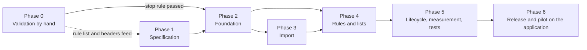

# Execution plan — ClaimCheck Rehab

Labels and sources: [Decision.md](Decision.md#how-numbers-are-labelled-used-in-all-ten-files). Estimates, dates and fixture values are author proposals `[P]`. Structure: phase → milestone → task → subtask. Owner roles: **Founder** (sales, audits, operator), **Dev** (developer; may be the founder), **Counsel** (external lawyer), **Clinic** (owner or front-desk lead). All scripts and commands are **proposed**; none exists.

## Phase map

- **Critical path:** T-0.1.3 → T-0.1.5 → T-0.1.4 → T-0.2.2 → T-0.3.2 → T-0.4.3 → T-2.2.1 → T-2.2.2 → T-3.1.1 → T-3.1.3 → T-4.1.1 → T-4.1.2 → T-4.2.1 → T-5.2.5 → T-6.1.1 → T-6.2.2.
- **Parallel work:** T-0.1.1 and T-0.1.2 with T-0.1.4; Phase 1 with milestone 0.3; T-2.1.x with T-2.2.x; T-3.1.1 (browser) with T-3.1.2 (server); T-4.1.2 with T-4.1.3; T-4.2.3 and T-4.2.4 with T-4.2.2.
- **External dependencies:** payment — T-0.4.1 (first CAD 89 invoices) gates T-0.4.3; sample data — T-0.3.1 gates every audit and T-0.1.2 gates T-1.1.2; permission — T-0.1.3 (signed agreement, counsel's reading) gates T-0.3.1; buyer decision — T-0.4.3 gates all of Phases 2–6.
- **Calendar:** Phase 0 from 16 November 2026 to the end of February 2027. Build only after a "go". 356–574 build hours ([effort summary](#effort-summary)) is 12–19 weeks for one developer at 30 hours a week, or about 5–8 weeks for two.

## Phase 0 — Validation by hand (no application)

Everything in this phase is done with spreadsheets, a phone, visits and paper. **A paid pilot is delivered before software exists:** the clinic prepares the two files on its own computer with a preparation workbook, they reach the founder without email, and the founder produces the Monday list by hand in a spreadsheet kept on one encrypted laptop. No outreach message is sent until T-0.1.3 and T-0.1.5 are accepted, because the message promises what the procedure below delivers.

### Phase 0 data procedure

This is the written by-hand procedure for real patient billing rows (finding F-001). It is part of the data agreement (T-0.1.3) and is tested in T-0.1.5 before any clinic is contacted. All of it is a proposal `[P]` pending counsel's reading.

| Step | What happens | Who, where, with what |
|---|---|---|
| 1 Prepare | Staff paste the two Jane exports into the **preparation workbook**: formulas only, no macros, no external links. A *Staff* sheet, filled once, turns each practitioner name into `physiotherapy`, `support` or `other`. A *Codes* sheet gives each claim number a sequential code (C0001, C0002, …) in order of first appearance; the same workbook is reused every week, so codes stay stable. Two output sheets hold the 16 fields of [schema.md](schema.md#2-minimum-authorized-pilot-data) and nothing else | Front-desk lead, on the clinic's computer. The first time, the founder is present at the desk and does not touch the keyboard |
| 2 Detach | Staff copy the two output sheets and paste **values only** into a new workbook, then tick the three-line check printed on the sheet: no names, no 10-digit numbers, no birth dates. The preparation workbook, with the pasted exports and the code table, never leaves the clinic | Front-desk lead |
| 3 Transfer | Either (a) in person, copied onto the founder's hardware-encrypted drive at the clinic, or (b) uploaded by staff through a single-use, write-only link valid 24 hours to a private storage bucket in AWS ca-central-1, encrypted at rest, whose lifecycle rule deletes every object after 7 days. **Never by email, messaging app or shared drive** | Front-desk lead; founder |
| 4 Check before keeping | The founder opens the file on the laptop and checks that the headers are exactly the 16 names, that no invoice reference is a 10-digit number or letters only, and that no date is before 2015. A file that fails is deleted from the bucket, drive and laptop without being read further; the clinic is asked to redo step 1; the event goes in the incident register | Founder |
| 5 Work | One laptop with full-disk encryption, in Vancouver; a dedicated folder excluded from every cloud sync and backup; no online spreadsheet, shared document or AI tool is given the rows | Founder |
| 6 Deliver | The audit page and the weekly list carry invoice numbers and amounts, so they are **not emailed**. They are handed over in person, or placed in the same bucket behind a single-use download link valid 72 hours, as a file opened with a password agreed in person. The Monday email says only that the list is ready | Founder |
| 7 If a file is emailed anyway | The founder does not open it, deletes it from inbox and trash, asks the clinic to delete it from Sent and trash, records it in the incident register and tells the clinic owner the same day. Copies on the mail providers' systems are outside both parties' control, which is why email is not used | Founder; clinic owner |
| 8 Keep and delete | Bucket: 7 days. Drive: wiped after each copy. Laptop: 30 days after the report for audit-only clinics; pilot end plus 30 days for paying clinics. Each deletion is entered in the deletion register and confirmed to the clinic owner in writing without row data (T-0.4.4) | Founder |

Limits, stated plainly: steps 1 and 2 are done by clinic staff with a spreadsheet and are not enforced by software; a column pasted in the wrong place can still carry an identifier out, and step 4 is the only second check. The sequential codes are reversible only with the clinic's table, but they are weaker than the application's keyed tokens if that table is ever copied. The bucket is the only cloud service that touches clinic rows in Phase 0.

### Milestone 0.1 — Evidence, authority and list

Entry: the portfolio owner approves the CAD 5,500 cap ([Decision.md section 9.3](Decision.md#93-costs-kept-apart)). Dependencies: none. Owner: Founder. Outcome: a rule list, a signed-off data pack, a tested data procedure and a counted prospect list. Exit: T-0.1.1 to T-0.1.5 accepted.

| Task | Need | Owner | Hours | Deliverable | Acceptance check |
|---|---|---|---|---|---|
| T-0.1.1 Rule list from primary sources | MH-03, MH-12 | Founder | 8–12 | The 18 rules of [TRD.md](TRD.md#deterministic-rules) as spreadsheet formulas, each with its PR-nn | Every rule cites a section of SRC-12, SRC-13, SRC-19 or SRC-20; chat's "20–30 checks" `[C]` not met and noted |
| T-0.1.2 Jane exports and live-account check | MH-02; Decision missing inputs 1–2 | Founder, Clinic | 4–8 | Header rows (no data rows) of the Sales and Insurance Policies exports; screenshots of Jane's Unsubmitted and Rejected folders with patient columns hidden | Written answer to: does Jane show days-to-deadline? are state dates, crash date and injury date exported? does the Sales export carry the claim number? |
| T-0.1.3 Data pack and legal reading | HCF-2; MH-01, MH-11 | Founder, Counsel | 8–14 | Two-page data agreement that includes the Phase 0 data procedure; one-page front-desk sheet; counsel's note on PIPA s. 18(2), s. 35, ICBC terms, WorkSafeBC agreement and the college standard | Counsel's note in hand **before** the first export is accepted; agreement lists the 16 fields, Canada, the transfer and delivery channel, retention and deletion as in [Decision.md section 6](Decision.md#6-minimum-authorized-pilot-data); every sentence of the outreach messages in Decision.md section 12 checked against the procedure and signed off |
| T-0.1.4 Prospect list and count | Decision sections 10, 12 | Founder | 10–16 | One row per clinic location: name, address, Jane yes/no, ICBC locator yes/no, practitioners, clinic owner's contact | Count of rows that fit the profile reported to the portfolio owner; if under 1,222 the report says break-even is out of reach by this channel |
| T-0.1.5 Preparation workbook, transfer channel and dry run | HCF-2; MH-01; finding F-001 | Founder | 8–12 | The preparation workbook; the ca-central-1 bucket with its 7-day lifecycle rule and link scripts; the encrypted drive; incident and deletion registers; a dry-run record | On a synthetic 22-column export containing names, health numbers and birth dates: the output sheets hold the 16 fields and none of those values; codes stay the same across two weekly pastes; the bucket's region and lifecycle rule are shown; a deliberately bad file is caught at step 4; no outreach before this passes |

Subtasks: T-0.1.1 — read sources, write formulas, build 20 synthetic rows with known answers, check formulas against them. T-0.1.2 — ask the first willing clinic for header-only exports, record answers, update the instruction sheet. T-0.1.3 — draft, send to counsel, revise, print. T-0.1.4 — pull directories, de-duplicate by address, check Jane booking address, tag fit. T-0.1.5 — build the workbook, write the front-desk sheet, create the bucket and links, run the dry run twice, record the result.

### Milestone 0.2 — Outreach and discovery

Entry: T-0.1.3, T-0.1.5 and the first 250 rows of T-0.1.4. Dependencies: email finder (about CAD 100 per 100 clinics `[C]`). Owner: Founder. Outcome: 16 clinics agree to an audit. Exit: 16 audits booked, or 444 clinics contacted, or the channel rule in [Decision.md section 12](Decision.md#12-go-to-market-plan) fires.

| Task | Need | Owner | Hours | Deliverable | Acceptance check |
|---|---|---|---|---|---|
| T-0.2.1 Walk into 15 clinics | First channel `[C]` | Founder | 8–10 | Visit log | 15 visits logged with outcome |
| T-0.2.2 Email sequence, 58 a week | Funnel | Founder | 24–40 | Sent log: first touch, follow-up, call | Weekly count within 50–65; reply rate computed weekly against the assumed 8% |
| T-0.2.3 Discovery calls | Decision section 13 | Founder | 10–16 | Notes on the five discovery questions `[C]` | Each call records ICBC and WorkSafeBC share, how rejections are found, write-offs last quarter, who reconciles, export willingness |
| T-0.2.4 Funnel log and weekly review | Stop rule | Founder | 4–8 | One sheet: contacted, replied, audit booked, audited, paid | Reviewed every Friday; numbers match the sent log |

Subtasks: T-0.2.2 — personalise from the list, send, follow up after 4 working days, call non-responders once. T-0.2.3 — book, ask, qualify or disqualify, send the column sheet.

### Milestone 0.3 — Free 90-day audit by hand (the decisive measurement)

Entry: a signed data agreement per clinic. Dependencies: the clinic's exports (sample data). Owner: Founder. Outcome: a one-page report per clinic with the three classes on separate lines. Exit: 16 reports delivered.

| Task | Need | Owner | Hours | Deliverable | Acceptance check |
|---|---|---|---|---|---|
| T-0.3.1 Prepare and receive the minimised export; timing sheet | MH-01, M-04; HCF-2 | Clinic, Founder | 8–12 | Per clinic: two files prepared and transferred by steps 1–3 of the Phase 0 data procedure; one week of timed minutes | Step 4 passed and logged for every file **before** it is kept; nothing received by email; the founder was present for each clinic's first preparation |
| T-0.3.2 Hand audit in a spreadsheet | MH-03, MH-05, M-01–M-03; HCF-1 | Founder | 32–64 | Per clinic: every flagged row with rule, limit date, class, near-limit yes/no; a separate list of rows that could not be checked (unknown state, service date before 2026-04-01, unmapped code) and rows with no rules applied | Second pass on a 10% sample reproduces the same flags; "could not check" rows listed and counted, never reported as fine; permanent loss, delayed cash and minutes on separate lines |
| T-0.3.3 One-page report and review call | Offer `[C]` | Founder | 16–24 | Report: permanent loss per month (certain, discretionary), near-limit delayed cash per month (band balance ÷ 0.5, as in Decision.md section 11.3), WorkSafeBC past-limit balance, minutes; delivered by step 6; after the first three audits, a one-page case study `[C]` with the clinic's written consent | Clinic owner confirms on the call which items were already known; the two stop-rule figures recorded separately |

Subtasks: T-0.3.2 — load, map payers, sort rows into in scope / could not check / no rules applied, apply formulas, mark near-limit, total by class, sample re-check. T-0.3.3 — write, send, 20-minute call, record the clinic owner's reaction and the CAD 89 ask.

### Milestone 0.4 — Paid pilot by hand and the stop-rule decision

Entry: at least one clinic owner says yes. Dependencies: payment; weekly exports. Owner: Founder. Outcome: paying clinics served weekly; a written go or stop. Exit: T-0.4.3 signed by the portfolio owner.

| Task | Need | Owner | Hours | Deliverable | Acceptance check |
|---|---|---|---|---|---|
| T-0.4.1 Pilot agreement and first invoice | Offer; M-05 | Founder, Clinic | 4–8 | One-page pilot terms with the refund test; CAD 89 invoice | Invoice paid before the second weekly list |
| T-0.4.2 Weekly hand-run list | MH-05, MH-07, MH-08; HCF-1 | Founder | 20–40 | Monday list per paying clinic, delivered by step 6 (never emailed); running ledger of near-limit items and payments seen | Ready by Monday 10:00; last week's marked items checked against the new export; any visit that passed a limit without having been on a list is recorded as an escape and reported to the clinic |
| T-0.4.3 Stop-rule decision | Decision section 11.3 | Founder | 3–5 | Memo: 16 audits, the two medians computed separately with the conversions of Decision.md section 11.3 (permanent loss ÷ 1.5; near-limit delayed cash ÷ 0.5), payers out of 16, weak-pass recomputation if 2 or 3 pay, counted pool, answers from T-0.1.2 | Both tests computed exactly as written; decision recorded as go, stop or re-price |
| T-0.4.4 Delete non-converting clinics' data | MH-11; PIPA s. 35(2) | Founder | 2–4 | Deletion register: clinic, date received, date deleted from laptop, bucket and drive | Every audit-only clinic deleted within 30 days of its report; clinic owner sent a written confirmation |

## Phase 1 — Specification and design

### Milestone 1.1 — Buildable specification

Entry: T-0.1.1 and T-0.1.2 done (may run during milestone 0.3; this is specification, not build). Dependencies: header rows. Owner: Dev. Outcome: rules, profiles and screens specified to the point where two developers would build the same thing. Exit: fixtures reviewed by the founder against three hand audits.

| Task | Need | Owner | Hours | Deliverable | Acceptance check |
|---|---|---|---|---|---|
| T-1.1.1 Rule catalogue with fixtures | MH-03, MH-12 | Dev, Founder | 12–20 | For each of 18 rules: parameters, an effective date range, at least 4 synthetic cases including one `not_evaluated`; the payer documents in force before 2026-04-01 obtained or recorded as unavailable; a reading note on the chiropractic and massage guides (not shipped) | Fixture answers agree with the hand formulas of T-0.1.1; no rule lacks an effective range |
| T-1.1.2 Export profile specification | MH-02 | Dev | 4–6 | Header maps v1 for both reports; required columns | Every one of the 16 fields mapped or marked "not exported" |
| T-1.1.3 Wireframes | MH-05, MH-07, MH-08 | Dev | 8–14 | S-05, S-07, S-08, S-10, S-12 | Each state in [App-flow.md](App-flow.md) drawn |
| T-1.1.4 Threat model and control review | HCF-2 | Dev | 4–6 | Review of [TRD.md](TRD.md#threat-model-short) against the as-specified flows; the health-number check-digit algorithm taken from the Ministry of Health's specification | Each abuse case has a named test |

## Phase 2 — Foundation

Entry for the whole phase: T-0.4.3 = go.

### Milestone 2.1 — Environment

Entry: go decision. Dependencies: AWS account in ca-central-1. Owner: Dev. Outcome: one command starts everything locally; staging exists. Exit: `make dev` (proposed) passes health checks on a clean machine; staging deploys from a tag.

| Task | Need | Owner | Hours | Deliverable | Acceptance check |
|---|---|---|---|---|---|
| T-2.1.1 Repository layout and shared core | R-03, R-04, R-06 | Dev | 6–10 | `apps/web`, `apps/api`, `apps/worker`, `packages/core`, `packages/minimiser`; import-boundary lint | Lint fails when `apps/api` imports `apps/worker` or a private module of core |
| T-2.1.2 Single start command and health checks | R-17 | Dev | 4–6 | `make dev`; `/healthz`, `/readyz`; worker heartbeat | Fresh clone to healthy stack with one command |
| T-2.1.3 Continuous integration | R-08, R-10 | Dev | 4–8 | Lint, types, tests, migration checks, image build | A second migration head fails the build |
| T-2.1.4 Staging and production | R-15, R-16; Canada `[C]` | Dev | 8–14 | EC2, RDS, SES, Parameter Store, Caddy, all ca-central-1 | Region verified for every resource; `PUBLIC_BASE_URL` set; no volume holds state; founder's VPS location recorded |
| T-2.1.5 Logging and correlation | R-07, R-12 | Dev | 4–6 | `packages/core.logging`; ID passed into jobs | Worker starts with no web framework installed; log scan finds no `invoice_ref` |

### Milestone 2.2 — Schema, identity, tenancy, jobs

Entry: T-2.1.1. Dependencies: none external. Owner: Dev. Outcome: two synthetic clinics that cannot see each other. Exit: IT-06 and IT-13 pass.

| Task | Need | Owner | Hours | Deliverable | Acceptance check |
|---|---|---|---|---|---|
| T-2.2.1 Baseline migrations and migration safety | R-08, R-09, R-10, R-11 | Dev | 10–16 | All tables of [schema.md](schema.md#3-data-dictionary); parity check; backfill runner; lock settings | IT-13 |
| T-2.2.2 Row-level security and tenancy module | MH-10; R-05 | Dev | 8–12 | Policies; one tenancy module; RLS audit script | IT-06; CI lists no clinic table without a policy |
| T-2.2.3 Sign-in, second factor, sessions | MH-10 | Dev | 14–22 | S-01, S-02, S-16 | E2E-05; UT for one-time code reuse |
| T-2.2.4 Users, invitations, roles | MH-10 | Dev | 6–10 | S-03, S-11 | Removed user's next request is refused |
| T-2.2.5 Audit events | MH-13 | Dev | 4–6 | Append-only table and writer | Application role cannot update or delete |
| T-2.2.6 Job runner | R-01, R-02 | Dev | 8–12 | Claim, lease, retry, dead state | UT-13; IT-10 |

## Phase 3 — Import

### Milestone 3.1 — Minimised import

Entry: milestone 2.2; T-1.1.2. Dependencies: header rows from a real clinic (no data). Owner: Dev. Outcome: a synthetic export goes from file to rows with nothing but the 16 fields on the wire. Exit: UT-11, UT-12, IT-01 to IT-05, IT-09 pass.

| Task | Need | Owner | Hours | Deliverable | Acceptance check |
|---|---|---|---|---|---|
| T-3.1.1 Browser minimiser | MH-01, MH-02 | Dev | 16–26 | Parse XLSX and CSV; profile match; drop; tokenise; location filter | UT-11 |
| T-3.1.2 Server intake and identifier guard | MH-01; HCF-2 | Dev | 8–12 | Strict schema; plausibility checks; `rejected_guard` path; `identifier_scan` job | UT-12, UT-15, IT-09, IT-18 |
| T-3.1.3 Finalize job, snapshots, counts | MH-02; R-19 | Dev | 10–16 | Upserts; count check; older-export rule | IT-01–IT-05, IT-10 |
| T-3.1.4 Onboarding, agreement, clinic key | MH-01, MH-11 | Dev | 10–16 | S-04; key creation and entry; re-key import | No import without acceptance; key absent from all requests |
| T-3.1.5 Import screens | MH-02; R-18, R-19 | Dev | 12–18 | S-05, S-06 | E2E-01, E2E-04, E2E-08 |

## Phase 4 — Rules and lists

### Milestone 4.1 — Rule engine

Entry: T-3.1.3; T-1.1.1. Dependencies: current payer documents (SRC-12, SRC-13, SRC-19, SRC-20). Owner: Dev. Outcome: fixtures pass for 18 rules. Exit: UT-01 to UT-10 pass; founder confirms three hand audits reproduce.

| Task | Need | Owner | Hours | Deliverable | Acceptance check |
|---|---|---|---|---|---|
| T-4.1.1 Engine, scope check and three outcomes | MH-03; HCF-1 | Dev | 10–16 | Rule interface; scope check before rules; independent evaluation; finding upsert | UT-05 (one rule `not_evaluated`, others still run), UT-09, UT-16 |
| T-4.1.2 ICBC rules | MH-03 | Dev | 12–20 | ICBC-01 to ICBC-08 | UT-01, UT-04–UT-07, UT-17, UT-19 |
| T-4.1.3 WorkSafeBC rules | MH-03 | Dev | 14–22 | WSBC-01 to WSBC-10 | UT-02, UT-03, UT-08, UT-18 |
| T-4.1.4 Daily evaluation, class changes and escape check | MH-04; HCF-1 | Dev | 6–10 | Scheduled job; old-import banner data; M-09 computed at every run | UT-10; IT-16; IT-17; an item changes class on the limit date + 1 |
| T-4.1.5 Rule versions, publication, payer-document watch | MH-12 | Dev, Founder | 10–16 | S-13, S-14; monthly calendar task to re-read SRC-12, SRC-13, SRC-19, SRC-20 | Publish refused when a fixture fails; a date without a fee version gives `not_evaluated` |

### Milestone 4.2 — Lists

Entry: T-4.1.1. Dependencies: wireframes (T-1.1.3). Owner: Dev. Outcome: staff can work the list. Exit: E2E-02, E2E-03 pass.

| Task | Need | Owner | Hours | Deliverable | Acceptance check |
|---|---|---|---|---|---|
| T-4.2.1 This week's list and CSV | MH-05; R-18, R-20; HCF-1 | Dev | 12–18 | S-07 | E2E-02, E2E-09 |
| T-4.2.2 Item detail and outcomes | MH-07 | Dev | 12–18 | S-08; bulk outcomes | E2E-03, IT-07, IT-08 |
| T-4.2.3 Unpaid list | MH-06 | Dev | 6–10 | S-09 | Totals reconcile with S-07 |
| T-4.2.4 Monday email | MH-09 | Dev | 4–6 | Job and template | IT-14 |

## Phase 5 — Lifecycle, measurement, tests

### Milestone 5.1 — Data lifecycle and pilot measurement

Entry: milestone 4.2. Dependencies: retention terms fixed in the data agreement (T-0.1.3). Owner: Dev. Outcome: the pilot metric and deletion work. Exit: IT-11, IT-12, IT-15 pass.

| Task | Need | Owner | Hours | Deliverable | Acceptance check |
|---|---|---|---|---|---|
| T-5.1.1 Pilot ledger and report | MH-08 | Dev | 10–16 | S-10; write-once near-limit date; refund test; exports-supplied count | M-01 on the synthetic clinic equals the hand-computed value; IT-19 |
| T-5.1.2 Retention and deletion jobs | MH-11; R-14 | Dev | 8–12 | `retention_purge`, `deletion_execute` | IT-11; staging rows older than 24 hours are gone |
| T-5.1.3 Data export, activity, support access, operator view | MH-11, MH-13 | Dev | 10–16 | S-12, S-15 | IT-15 |

### Milestone 5.2 — Test suites

Entry: features complete. Dependencies: staging environment (T-2.1.4). Owner: Dev. Outcome: the planned tests exist and run in CI. Exit: all tests in [Planned tests](#planned-tests) pass on staging with synthetic data.

| Task | Need | Owner | Hours | Deliverable | Acceptance check |
|---|---|---|---|---|---|
| T-5.2.1 Unit suite | MH-03 | Dev | 8–12 | UT-01–UT-19 | Green in CI |
| T-5.2.2 Integration suite | MH-01, MH-10 | Dev | 10–16 | IT-01–IT-19 | Green in CI against real PostgreSQL |
| T-5.2.3 End-to-end suite | all screens | Dev | 10–16 | E2E-01–E2E-09 | Green on staging |
| T-5.2.4 Accessibility checks | [design.md](design.md#8-accessibility-map) | Dev | 6–10 | Manual check record; contrast measurements | Each row of the map marked pass or fail with evidence |
| T-5.2.5 Permission, concurrency, migration, recovery | R-01, R-02, R-05, R-09 | Dev | 10–16 | Tests listed under those headings; 5-clinic load script | Green |

## Phase 6 — Release and pilot on the application

### Milestone 6.1 — Production readiness

Entry: milestone 5.2. Dependencies: production account in ca-central-1 (T-2.1.4). Owner: Dev. Outcome: production can be restored and rolled back. Exit: drill records filed.

| Task | Need | Owner | Hours | Deliverable | Acceptance check |
|---|---|---|---|---|---|
| T-6.1.1 Backup and restore drill | R-15; MH-11 | Dev | 4–8 | Restore to a new instance with deletion replay | Done within 4 hours; deleted synthetic clinic absent |
| T-6.1.2 Monitoring and alerts | R-12 | Dev | 4–8 | Alerts in [TRD.md](TRD.md#7-deployment-view) | Each alert fired once on purpose |
| T-6.1.3 Rollback rehearsal | Release | Dev | 3–5 | Previous tag redeployed against new schema | Health checks pass |
| T-6.1.4 Security review | HCF-2 | Dev | 6–10 | Each targeted ASVS requirement marked verified, failed or untested with evidence | No requirement marked verified without a test or inspection record |
| T-6.1.5 Release checklist and branch hygiene | R-21, R-22 | Dev | 2–4 | Checklist; branch naming and deletion rule | No merged branch remains; every merged change cites an MH or R |

### Milestone 6.2 — Pilot on the application

Entry: milestone 6.1; at least one paying clinic. Dependencies: clinic's staff time for onboarding. Owner: Founder. Outcome: hand-run pilots moved over; the application matches the manual audits (the chat's week-3 gate `[C]`). Exit: day-90 review held for each pilot clinic.

| Task | Need | Owner | Hours | Deliverable | Acceptance check |
|---|---|---|---|---|---|
| T-6.2.1 Move hand-run pilots | MH-01 | Founder, Clinic | 6–10 | Each clinic onboarded on S-04; spreadsheets deleted and logged | First application import done by clinic staff unaided |
| T-6.2.2 Parallel run against manual audits | MH-03; M-09 | Founder | 8–12 | Two weeks of both lists per clinic | Every difference explained; zero unexplained misses |
| T-6.2.3 Day-90 review and conversion | M-01–M-06 | Founder, Clinic | 4–8 | Pilot report walked through; refund test applied; tier chosen | Refund paid where due; conversion recorded |
| T-6.2.4 Expansion decision | PRD section 13 | Founder | 1–3 | Memo | Decision tied to the evidence table |

## Effort summary

| Phase | Hours (low–high) |
|---|---|
| 0 Validation by hand | 169–293 |
| 1 Specification | 28–46 |
| 2 Foundation | 76–122 |
| 3 Import | 56–88 |
| 4 Rules and lists | 86–136 |
| 5 Lifecycle, measurement, tests | 72–114 |
| 6 Release and pilot | 38–68 |
| **Build (phases 1–6)** | **356–574** |

The chat estimated 120 hours and 15 days `[C]`. The difference is the in-browser minimiser, tenancy, lifecycle and tests, none of which the chat's estimate itemised. Phase 0 at 169–293 hours over about 15 weeks is above the chat's 60 founder hours a month `[C]` at the high end.

## Proposed scripts

| Script (proposed) | Purpose | Inputs | Outputs | Failure behaviour |
|---|---|---|---|---|
| `make dev` | Start database, run migrations, start API, worker, web, mail catcher | `.env.local` | Health summary | Stops and names the first unhealthy service |
| `scripts/check_migrations.py` | ORM parity, single head, tables without RLS policy, invalid indexes | Database URL | Report; exit code | Non-zero on any difference; changes nothing |
| `scripts/backfill_runner.py` | Run a named backfill in batches with a checkpoint | Backfill name, batch size | Rows done, checkpoint | Stops on error; safe to re-run from the checkpoint |
| `scripts/seed_synthetic.py` | Create two synthetic clinics and the fixture exports | Seed number | Files and rows | Refuses to run when the environment is production |
| `scripts/restore_replay.py` | Replay deletion requests after a restore | Backup timestamp | Row counts per clinic | Leaves the database closed to users on any error |
| `scripts/phase0_links.sh` | Phase 0 only: create a single-use upload or download link for one clinic in the ca-central-1 bucket | Clinic code, direction, lifetime | A link | Refuses any region other than ca-central-1 and any lifetime over 72 hours |
| `scripts/log_scan.py` | Search logs for forbidden patterns (invoice references, 10-digit numbers, email addresses of non-staff) | Log export | Matches | Non-zero if any match |

## Planned tests

All fixtures are synthetic. The base fixture is "Harbourview Physio": 1,184 visits (ICBC 702, WorkSafeBC 311, other 171), 388 claims, two users, service dates 12 August to 9 November 2026. A second clinic, "Seawall Rehab", exists for isolation tests.

### Unit

| ID | Fixture and action | Expected |
|---|---|---|
| UT-01 | ICBC visit, service 2026-10-01, unsubmitted; evaluate on 10-14, 10-15, 11-01, 11-15, 11-16 | Clear; flag (limit 2026-11-15, submit by 11-14, delayed cash, not near-limit); near-limit date written as 11-01 (day 31); still delayed cash; discretionary permanent loss |
| UT-02 | WorkSafeBC visit, service 2026-07-01, unsubmitted | Limit 2026-09-29, submit by 09-28 |
| UT-03 | WorkSafeBC visit, service 2026-03-01, rejected; first rejection 2026-08-20, then unknown | Limit 2026-11-18; with unknown date, limit 2026-08-28 |
| UT-04 | ICBC claim with 25, 26, and 22 treatments plus a next appointment; then policy maximum 35 | Clear; flag; warning; clear |
| UT-05 | ICBC visit on 2026-08-25, crash 2026-06-01, no end date; then crash date and end date both null | Flag (period ended 2026-08-24); `not_evaluated(missing_dates)` **and** ICBC-01 still returns its own result |
| UT-06 | Second Initial Visit on a claim; two sessions one day | ICBC-04 flag; ICBC-05 flag |
| UT-07 | Jane code amount 95.00 for a Standard Treatment on 2026-05-04, unpaid; the same paid at 95.00; the same on 2026-03-15 | ICBC-06 flag as "Jane set-up", no loss amount; certain permanent loss 2.00 because the paid amount is below the schedule; `not_evaluated(no_rule_version)` and the visit listed as "could not check" |
| UT-08 | 19102 with 19100 same day; 19100 at 60 and 61 days after injury; 11th visit; 19102 at 95.00 | WSBC-05 flag; clear then flag; WSBC-07 warning; WSBC-08 clear |
| UT-09 | Property test: any row set, evaluated twice and in shuffled order | Identical findings |
| UT-10 | Unsubmitted ICBC visit at 13, 14, 30 and 31 days; a visit submitted on day 20 | No item; item with `reached_near_limit_on` null; still null; set to day 31 and unchanged afterwards; never set |
| UT-11 | 22-column export file through the minimiser with two different keys | Exactly 16 fields plus 2 ordinals; no dropped value present anywhere in output; tokens differ between keys and repeat within a key |
| UT-12 | Payload with key `patient_name`; payload with `invoice_ref` "Priya Sharma" | Both rejected whole |
| UT-13 | Job completed with a stale lease token | Zero rows updated; logged |
| UT-14 | Start with a missing setting | Process exits naming the variable |
| UT-15 | Four guard fixtures: `invoice_ref` column holding 10-digit numbers that pass the health-number check digit; holding one-word surnames; holding patient numbers that repeat (30% distinct); a date field holding 1984-06-02 | Each batch rejected whole; nothing stored. A fifth fixture, patient numbers with 80% distinct values, **passes**, and the test records this as the known residual gap |
| UT-16 | In-scope ICBC visit with state `unknown`; one with service date 2026-03-15; one with an unmapped code; an ICBC kinesiology visit | First three: "could not check" with the reason, deadline rules `not_evaluated`, fee and claim rules still attempted; fourth: "no rules applied"; none `clear`; all four counted on the list |
| UT-17 | ICBC visit, service 2026-10-01, Jane state submitted, unpaid; evaluate on 10-15 and 11-10; then outcome "portal: not received" | "Verify in ICBC's portal" with limit 2026-11-15 and days left shown both times; after the outcome, ICBC-01 applies and the item is near-limit |
| UT-18 | WorkSafeBC claim with nine 19102 visits and two 19108 sessions by a support worker; a 19102 and a 19107 on one day | WSBC-07 counts 11 and warns; WSBC-04 flags the same-day pair |
| UT-19 | Hand Therapy 30-minute session at 110.00 on 2026-09-26 and on 2026-09-28; every rule code queried for 2026-03-15 | `not_evaluated(no_rule_version)` on 09-26; clear on 09-28; every rule returns `not_evaluated`, none returns `clear` |

### Integration (real PostgreSQL)

| ID | Fixture and action | Expected |
|---|---|---|
| IT-01 | Import base fixture | `completed`; 1,184 accepted; counts add up |
| IT-02 | Import the same content again | Same batch returned; no new rows |
| IT-03 | Fixture with 3 unreadable rows | `completed_with_rejects`; 3 row numbers and reasons |
| IT-04 | 5,000-row fixture | Finalized within 60 s |
| IT-05 | Import 9 Nov export, then 2 Nov export | Snapshots stored; current state still from 9 Nov |
| IT-06 | Seawall user requests a Harbourview item; SQL under the app role with Seawall's setting; worker job for Harbourview | 404 and audit event; zero rows; job reads only Harbourview |
| IT-07 | Two outcome saves on the same item version | One succeeds, one 409 |
| IT-08 | Mark submitted; next export still unsubmitted; following export submitted | Awaiting confirmation; reopened; confirmed |
| IT-09 | Row batch failing the guard | 422; no `import_row`; batch `rejected_guard`; audit event without values |
| IT-10 | Kill the worker during finalize | Retry completes; no duplicate visit or snapshot |
| IT-11 | Delete Harbourview | No clinic-owned rows; audit rows remain; sessions revoked; second run is a no-op |
| IT-12 | Back up, delete Seawall, restore, replay | Seawall absent after replay |
| IT-13 | Parity check; add a second head; interrupt a backfill; fail a concurrent index | Pass; build fails; resumes from checkpoint; invalid index detected and rebuilt |
| IT-14 | Run the weekly email job twice in one week | One email; body has counts and a link on `PUBLIC_BASE_URL`; no invoice reference or amount |
| IT-15 | Operator reads visits without, with, and after an expired grant | Denied; allowed; denied |
| IT-16 | Latest import 9 days old; evaluation job stopped for 36 hours | Banner with the import date on S-07 and S-09; "last checked" date shown; operator alert |
| IT-17 | Plant a visit that passes PR-01 while present in imports and with no item or "could not check" entry | M-09 = 1 on the pilot report; operator alert; the visit appears in the escape list |
| IT-18 | Insert a stored `invoice_ref` that passes the health-number check, bypassing the API; run `identifier_scan` | Alert raised; imports for the clinic paused |
| IT-19 | Pilot clinic with 11 imports in 13 weeks, one week without an export | Report shows "11 of 13"; that week's email says no export arrived (MH-08 c, MH-09 c) |

### End-to-end (Playwright, staging)

| ID | Flow | Expected |
|---|---|---|
| E2E-01 | Owner: invitation → code → onboarding → import → list | List shows the fixture's known 7 deadline items |
| E2E-02 | Filter, open item, Back; deep link while signed out | Filters and scroll restored; returned to the link after sign-in; p95 under 800 ms |
| E2E-03 | Resolve, undo, bulk 50 with one item changed by another user | 49 done, 1 skipped, shown as such |
| E2E-04 | Export with a renamed required column | Blocked; column named; header-only send works |
| E2E-05 | Sign in, idle 30 minutes, return; owner removes the user | S-16 then back to the URL; next request refused |
| E2E-06 | Delete clinic data | Review step; password and code; confirmation |
| E2E-07 | Whole primary flow by keyboard; axe scan on S-01, S-05, S-07, S-08, S-12 | No blocker; scan results recorded (not a conformance claim) |
| E2E-08 | Refresh during processing; double Confirm | Same status; one batch |
| E2E-09 | Import a fixture in which 43 ICBC and WorkSafeBC rows have an unrecognised state and nothing else is flagged | Review step shows the 43; the list says 970 checked, 43 could not be checked, 171 no rules applied; the words "nothing needs action" never appear without those counts; the Monday email carries the same three counts |

### Permission
Each API route called as `staff`, `owner`, `operator`, signed-out and as a user of the other clinic; expected status asserted from the permission table in [schema.md](schema.md#5-permissions-tenant-boundary-uniqueness).

### Concurrency
Two imports for one clinic at once (processed in export-date order); five clinics importing together (T-5.2.5); two workers claiming one job (one wins).

### Migration
IT-13, plus upgrade from each released schema version on a copy of staging.

### Recovery and networking
IT-10, IT-12; API restarted during row upload (browser resumes); email provider refused (retried, list unaffected); request through the proxy produces links on `PUBLIC_BASE_URL` only.

### Accessibility and human review
T-5.2.4 manual checks; E2E-07; a reviewer who is not the developer walks S-05 and S-12 and confirms that the review step shows what the action will do before it happens.
