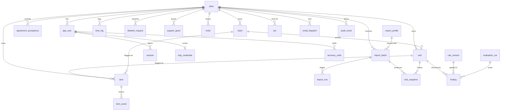

# Schema — ClaimCheck Rehab

Labels and sources: [Decision.md](Decision.md#how-numbers-are-labelled-used-in-all-ten-files). Table, field and index names, types, retention periods and limits are author proposals `[P]`. PostgreSQL 16. Nothing here exists yet; migrations are described, not created.

## 1. Entity-relationship diagram

## 2. Minimum authorized pilot data

This is the whole of what a clinic sends. In the application the browser produces it. In Phase 0 the clinic produces the same 16 fields with a preparation workbook that stays on its own computer, and the claim code is a sequential code instead of a keyed token ([Phase 0 data procedure](execution-plan.md#phase-0-data-procedure)). Jane publishes no column list for its exports `[S: SRC-08]` `[S: SRC-09]`; the Jane names below are the report fields its guides name, and the exact headers are captured from header-only files in T-0.1.2.

**Kept or transformed (16 fields).**

| # | Field | Jane report and field | Treatment before upload | Needed for |
|---|---|---|---|---|
| 1 | `invoice_ref` | Sales: invoice number | Kept in clear | Finding the visit in Jane; duplicate detection |
| 2 | `date_of_service` | Sales: purchase or appointment date | Kept | Every deadline rule |
| 3 | `payer` | Sales: payer (insurer name) | Mapped to `ICBC`, `WSBC` or `OTHER` (insurers listed in the profile); any other wording becomes `UNKNOWN`, which is "could not check" (fix round 1, B1-007) | Rule selection |
| 4 | `billing_code` | Sales: item or billing code | Mapped by the export profile to the payer's code (ICBC service type `ICBC-IV`, `ICBC-ST`, `ICBC-SE`, `ICBC-HT15/30/45`, or the WorkSafeBC fee item); any other code becomes `UNMAPPED` (B1 clarification) | Fee and combination rules |
| 5 | `amount_invoiced` | Sales: amount to insurer | Kept | Class totals, fee rules |
| 6 | `amount_paid` | Sales: insurer payment applied | Kept | Unpaid list, M-01 |
| 7 | `submission_state` | Sales or Billing: payment status and claim state | Mapped to a closed list; any wording the profile does not recognise becomes `unknown`, which is never treated as fine | Deadline and unpaid rules |
| 8 | `state_date` | Date of the last state change, **if Jane exports it** | Kept; null otherwise | Near-limit test, WSBC-02 |
| 9 | `discipline` | Sales: staff member | **Replaced** at the clinic by `physiotherapy`, `support` (kinesiologist or support worker under a physiotherapist) or `other` | Rule selection; PR-04 |
| 10 | `claim_token` | Sales and Insurance Policies: Claim # or Policy # | **Tokenised** in the browser (HMAC-SHA-256 under the clinic key, 128 bits); in Phase 0 a sequential code from a table that stays at the clinic | Grouping visits by claim |
| 11 | `policy_status` | Insurance Policies: Status | Mapped to the closed list `open`, `closed`, `other` (B1: no free text on the wire) | WSBC-09 |
| 12 | `end_date` | Insurance Policies: End Date | Kept | ICBC-03, WSBC-07 |
| 13 | `treatments_count` | Insurance Policies: Number of Treatments | Kept | ICBC-02, WSBC-07 |
| 14 | `policy_max` | Insurance Policies: Policy Maximum | Kept | ICBC-02, ICBC-08 |
| 15 | `next_appointment_date` | Insurance Policies: Next Appointment | Kept (date only) | Warnings before the visit |
| 16 | `date_of_event` | Date of crash or injury, **if Jane exports it** | Kept; null otherwise | ICBC-03, WSBC-06 |

The browser adds two ordinals of its own, `row_no` (transport) and `line_no` (position within an invoice). The server accepts exactly these 18 keys.

**Which Jane exports (C1, one definition for the free audit and every week).** Two files: the Sales report's invoice lines for ICBC and WorkSafeBC with a date range starting 365 days before the export date `[P]`, and the Insurance Policies report. A "last 90 days" export alone is not used: it would miss older invoices still open, including WorkSafeBC rejections still inside the PR-08 window. The columns the rules depend on most are payer (#3), amount paid as the payment outcome (#6), the claim-submission state (#7) and its date (#8). The **original submission date** and the **first rejection date** are not among the 16 fields: #8 is the date of the last state change only, so the product shows bounds and asks staff to confirm the exact date in ICBC's portal or Teleplan (open decision OD-3 in [Decision.md section 16](Decision.md#16-open-decisions-for-the-owner)). **Jane's "Submitted" state (#7) does not prove that the payer received, accepted or will pay the invoice;** only a recorded payment does.

**What leaves the clinic and where it is hosted (C1).** Exactly the 16 fields above and the two ordinals, per row; nothing else. They are pseudonymised personal information, not anonymous: #1 (Jane invoice number) is in clear. Phase 0: an encrypted drive or a storage bucket in AWS ca-central-1 (7 days), then one encrypted laptop in Vancouver. Application (proposed, not deployed): PostgreSQL, the import payload store (24 hours, AD-11), backups and email in AWS ca-central-1. B2 development build: a local PostgreSQL database and a local MinIO store on the developer's machine, synthetic rows only. Do not describe this as "patient data stays in the clinic".

**Dropped in the browser and never sent.** Patient name; patient number; date of birth; personal health number; address; phone; email; adjuster name, email and phone; policy notes; internal policy name; diagnosis, area-of-injury and anatomical codes; practitioner name; location name (used only to filter rows); any column not listed above.

**Never requested.** Charts, intake forms, appointment notes, remittance documents, payer letters.

**If a field is missing.** Nobody is asked to type it. Rules that need it return `not_evaluated` with the reason. If the Sales export carries no claim number, claim-level rules (ICBC-02 to ICBC-05, WSBC-04 to WSBC-07, WSBC-09) are not evaluated and the deadline, fee and unpaid rules still run.

**Status of this data.** Pseudonymised, and still personal information of the clinic's patients `[A]`: the clinic can re-link every row. Authority, location and retention are in [Decision.md section 6](Decision.md#6-minimum-authorized-pilot-data).

## 3. Data dictionary

Conventions: `id uuid` primary key (generated by the database); `created_at timestamptz not null default now()`; every clinic-owned table has `clinic_id uuid not null` referencing `clinic(id)` and is covered by row-level security. "NN" = not null.

| Table | Fields (type, nullability, default, constraint) |
|---|---|
| `clinic` | `name text NN`; `location_label text NN`; `status text NN default 'onboarding'` check in (`onboarding`,`audit_only`,`pilot`,`active`,`closed`); `pilot_started_on date null`; `audit_report_sent_on date null`; `timezone text NN default 'America/Vancouver'`; `payers text[] NN` |
| `app_user` | `clinic_id uuid null` (null only for `operator`); `email citext NN unique`; `password_hash text NN`; `role text NN` check in (`owner`,`staff`,`operator`); `disabled_at timestamptz null`; check (`role='operator'` = `clinic_id is null`) |
| `totp_credential` | `user_id uuid NN unique` → `app_user`; `secret_enc bytea NN`; `confirmed_at timestamptz null`; `last_used_step bigint null` |
| `recovery_code` | `user_id NN`; `code_hash text NN`; `used_at null`; unique (`user_id`,`code_hash`) |
| `session` | `user_id NN`; `token_hash text NN unique`; `mfa_passed boolean NN default false`; `last_seen_at NN`; `expires_at NN`; `revoked_at null` |
| `invite` | `clinic_id NN`; `email citext NN`; `role NN`; `token_hash text NN unique`; `expires_at NN`; `accepted_at null`; unique (`clinic_id`,`email`) where `accepted_at is null` |
| `agreement_acceptance` | `clinic_id NN`; `user_id NN`; `agreement_version text NN`; `accepted_at NN`; unique (`clinic_id`,`agreement_version`) |
| `password_reset` (B2) | `user_id NN` → `app_user`; `token_hash text NN unique`; `expires_at NN` (30 minutes); `used_at null`. A new request marks older unused rows used |
| `auth_attempt` (B2) | `bucket text NN` (kind plus a SHA-256 prefix of the account or client address, never the value); index (`bucket`,`created_at`). Rate-limit windows of 15 minutes |
| `export_profile` | `report text NN` check in (`sales`,`policies`); `version int NN`; `header_map jsonb NN`; `required text[] NN`; `published_at null`; unique (`report`,`version`) |
| `import_batch` | `clinic_id NN`; `created_by NN`; `content_hash text NN`; `export_date date NN`; `profile_sales_id`, `profile_policies_id uuid NN`; `status text NN default 'receiving'` check in (`receiving`,`processing`,`completed`,`completed_with_rejects`,`failed`,`rejected_guard`); `rows_received`, `rows_accepted`, `rows_rejected`, `rows_duplicate int NN default 0`; `correlation_id uuid NN`; `completed_at null`; unique (`clinic_id`,`content_hash`); check (`status` not in (`completed`,`completed_with_rejects`) or `rows_received = rows_accepted + rows_rejected + rows_duplicate`) |
| `import_row` | `clinic_id NN`; `batch_id NN`; `row_no int NN`; `kind text NN` check in (`visit`,`claim`); `payload jsonb NN`; `reject_reason text null`; unique (`batch_id`,`kind`,`row_no`). Staging only |
| `claim` | `clinic_id NN`; `claim_token char(32) NN`; `payer text NN`; `policy_status text null`; `end_date date null`; `treatments_count int null`; `policy_max int null`; `next_appointment_date date null`; `date_of_event date null`; `last_batch_id NN`; `updated_at NN`; unique (`clinic_id`,`claim_token`,`payer`) |
| `visit` | `clinic_id NN`; `invoice_ref text NN`; `line_no int NN default 1`; `claim_id uuid null`; `payer text NN`; `discipline text NN` check in (`physiotherapy`,`support`,`other`); `date_of_service date NN`; `billing_code text NN`; `amount_invoiced numeric(10,2) NN` check ≥ 0; `amount_paid numeric(10,2) NN default 0` check ≥ 0; `submission_state text NN` check in (`unsubmitted`,`submitted`,`rejected`,`partly_paid`,`paid`,`unknown`); `state_date date null`; `first_rejected_on date null`; `first_seen_batch_id NN`; `last_batch_id NN`; `last_export_date date NN`; unique (`clinic_id`,`invoice_ref`,`line_no`) |
| `visit_snapshot` | `clinic_id NN`; `visit_id NN`; `batch_id NN`; `export_date date NN`; `submission_state NN`; `amount_invoiced NN`; `amount_paid NN`; `state_date null`; unique (`visit_id`,`batch_id`). Append-only |
| `rule_version` | `rule_code text NN` (e.g. `ICBC-01`); `version int NN`; `effective_from date NN`; `effective_to date null`; `params jsonb NN`; `source_citation text NN`; `source_id text NN` (SRC-nn); `status text NN default 'draft'` check in (`draft`,`published`,`superseded`); `fixtures_passed_at null`; `published_by null`; `published_at null`; unique (`rule_code`,`version`); exclusion constraint: no two published versions of one `rule_code` with overlapping date ranges |
| `evaluation_run` | `clinic_id NN`; `local_date date NN`; `rule_set_hash text NN`; `trigger text NN` check in (`import`,`daily`,`rule_publish`); `status NN`; `correlation_id NN`; unique (`clinic_id`,`local_date`,`rule_set_hash`,`trigger`) |
| `finding` | `clinic_id NN`; `visit_id null`; `claim_id null`; `rule_code NN`; `rule_version_id NN`; `outcome text NN` check in (`flag`,`clear`,`not_evaluated`); `reason_code text null` (required when `not_evaluated`); `limit_date date null`; `submit_by date null`; `evaluation_run_id NN`; `evaluated_on date NN`; check (exactly one of `visit_id`,`claim_id`); unique (`visit_id`,`rule_code`) where `visit_id is not null`; unique (`claim_id`,`rule_code`) where `claim_id is not null` |
| `item` | `clinic_id NN`; `visit_id null`; `claim_id null`; `rule_code NN`; `money_class text NN` check in (`permanent_certain`,`past_deadline_discretionary`,`confirmed_unpaid`,`delayed_cash`,`admin_time`,`warning`) (C1, migration `202611120100`: `permanent_discretionary` renamed; a payer deadline passed is not a loss); `amount numeric(10,2) null` (null for `admin_time` and `warning`); `limit_date null`; `status text NN default 'open'` check in (`open`,`awaiting_confirmation`,`confirmed`,`auto_cleared`,`written_off`,`dismissed`); `first_flagged_on date NN`; `reached_near_limit_on date null` (written once); `class_at_first_flag text NN`; `paid_after_flag numeric(10,2) NN default 0`; `version int NN default 1`; unique (`clinic_id`,`visit_id`,`rule_code`) and (`clinic_id`,`claim_id`,`rule_code`) |
| `item_event` | `clinic_id NN`; `item_id NN`; `actor_user_id null` (null = system); `kind text NN` check in (`flagged`,`class_changed`,`outcome`,`undone`,`reopened`,`confirmed`,`auto_cleared`); `outcome text null` check in (`submitted`,`verified_in_portal`,`portal_not_received`,`payer_declined`,`corrected_resubmitted`,`treatment_plan_requested`,`written_off`,`not_an_error`) (`payer_declined` added in C1); `reason_code text null` check in (`already_paid`,`payer_approved`,`duplicate_row`,`rule_wrong`,`not_our_claim`,`other`); `idempotency_key text NN`; unique (`item_id`,`idempotency_key`). Append-only |
| `time_log` | `clinic_id NN`; `iso_week char(8) NN`; `kind text NN` check in (`baseline`,`chasing`,`export`); `minutes int NN` check 0–10080; `entered_by NN`; unique (`clinic_id`,`iso_week`,`kind`) |
| `job` | `clinic_id null`; `kind text NN`; `idempotency_key text NN unique`; `status text NN default 'queued'` check in (`queued`,`running`,`succeeded`,`failed`,`dead`); `attempt int NN default 0`; `run_after timestamptz NN`; `lease_token uuid null`; `lease_expires_at null`; `correlation_id NN`; `last_error_code text null` |
| `email_dispatch` | `clinic_id NN`; `kind text NN`; `iso_week char(8) NN`; `sent_at null`; `provider_id text null`; unique (`clinic_id`,`kind`,`iso_week`) |
| `audit_event` | `clinic_id null`; `actor_user_id null`; `action text NN`; `object_type text null`; `object_id uuid null`; `outcome text NN`; `correlation_id NN`; `ip_hash text null`; `meta jsonb NN default '{}'` (counts and codes only). Append-only |
| `deletion_request` | `clinic_id NN` (no foreign key, so the record outlives the clinic rows); `requested_by null`; `scope text NN` check in (`clinic`,`batch`,`audit_expiry`); `batch_id null`; `status text NN default 'pending'`; `row_counts jsonb null`; `completed_at null` |
| `support_grant` | `clinic_id NN`; `granted_by NN`; `expires_at NN`; `revoked_at null`; check (`expires_at <= created_at + interval '72 hours'`) |

**Fix round 1 (2026-11-11) changes** (migration `202611111200_fix_round1`): `visit.check_status` adds `rules_not_evaluated` (B1-002); `visit.payer` and `claim.payer` add `UNKNOWN` (payer wording not recognised, B1-007); `visit.check_reason` holds every `RULE:reason` or scope reason, comma-separated, from fixed lists; `import_row.reject_reason` is one of `missing_required`, `duplicate_row`, `conflicting_duplicate` (B1-001); a second application role `claimcheck_worker` (NOSUPERUSER, NOBYPASSRLS) alone may execute `cc_job_claim`, `cc_job_complete`, `cc_job_expire_leases` and `cc_enqueue_per_clinic`; `claimcheck_app` no longer can (B1-008). Open item restated: the owner of these `SECURITY DEFINER` functions is the superuser locally; in production it must be a dedicated non-login role that bypasses row-level security on `job` and `clinic` (BYPASSRLS, or a policy for that role), because `job` has FORCE ROW LEVEL SECURITY. **Fixed after retest (round 2, 2026-11-11):** closed by migration `202611111500_round2`: the four queue functions are owned by `claimcheck_queue_owner` (NOLOGIN, NOSUPERUSER, NOBYPASSRLS, NOINHERIT), which has SELECT, INSERT, UPDATE on `job` and SELECT on `clinic` through the policies `job_queue_owner` and `clinic_queue_owner` granted to that role only; search_path is `pg_catalog, public, pg_temp`. Locally and in production the same. `cc_session_principal` was still owned by the migration user; **fixed after round-3 retest, lead-checked:** migration `202611111800_session_owner` gives it the owner `claimcheck_session_owner` (NOLOGIN, NOSUPERUSER, NOBYPASSRLS, NOINHERIT) with SELECT, UPDATE on `session` and SELECT on `app_user` through the policy `app_user_session_owner` for that role only; search_path `pg_catalog, public, pg_temp`; EXECUTE for `claimcheck_app` only. The same migration adds `finding.latest_limit_date` (date, null): the latest possible limit when the true limit is uncertain (WSBC-02, B1-010).

**B1 implementation notes (2026-11-11).** The baseline migration `202611110900_baseline` creates the core subset: `clinic`, `app_user`, `session`, `export_profile`, `import_batch`, `import_row`, `claim`, `visit`, `visit_snapshot`, `rule_version`, `evaluation_run`, `finding`, `item`, `item_event`, `job`, `audit_event`. Not yet created: `totp_credential`, `recovery_code`, `invite`, `agreement_acceptance`, `time_log`, `email_dispatch`, `deletion_request`, `support_grant`. Columns added beyond the dictionary above, each needed by the core: `clinic.imports_paused_at` (identifier_scan pause); `import_batch.expected_rows` (finalize count check); `visit.first_seen_export_date` (M-09 "present at least 7 days before the limit"); `visit.check_status` in (`in_scope`,`could_not_check`,`no_rules_applied`) and `visit.check_reason` (the list counts); `evaluation_run.finished_at` (the "last checked" banner); `job.max_attempts`, `job.payload` (ids and dates only) and `job.finished_at`. Changed: `finding.rule_version_id` is nullable, but only when `outcome = 'not_evaluated'` and `reason_code = 'no_rule_version'` (there is no version to name); `item_event.outcome` is a closed list (`submitted`, `verified_in_portal`, `portal_not_received`, `corrected_resubmitted`, `treatment_plan_requested`, `written_off`, `not_an_error`); `audit_event.clinic_id` has no foreign key, so audit rows outlive deleted clinic rows; item uniqueness uses partial unique indexes so that the null side of (`visit_id`,`claim_id`) does not defeat it. The job queue functions (`cc_job_claim`, `cc_job_complete`, `cc_job_expire_leases`, `cc_enqueue_per_clinic`) and the session lookup (`cc_session_principal`) are `SECURITY DEFINER` functions, because the worker must see queued jobs of every clinic before it can set `app.clinic_id`; the application role has no direct grant on `session`. They are owned by the dedicated non-login roles `claimcheck_queue_owner` (queue) and `claimcheck_session_owner` (session lookup), locally and in production.

**C1 changes (2026-11-11)** (migration `202611120100_c1_money_classes`): `item.money_class` and `item.class_at_first_flag` rows with `permanent_discretionary` are renamed `past_deadline_discretionary` (the write-once trigger is disabled for that one statement and re-enabled); the class `confirmed_unpaid` and the outcome `payer_declined` are added to the check constraints. Rule versions 1 of WSBC-01, -02, -03, -04, -07, -10 become `superseded` when version 2 is published (status value already in the check).

**B2 changes (2026-11-11)** (migration `202611112000_b2_auth_storage`): new tables `totp_credential`, `recovery_code`, `invite`, `password_reset`, `auth_attempt` as in the dictionary; `invite` also has `invited_by uuid null` → `app_user` (null = operator) and role check (`owner`,`staff`), and the pending-uniqueness is the partial unique index `ux_invite_pending` on (`clinic_id`,`email`) where `accepted_at is null`; `invite` is clinic-owned with forced RLS (`invite_tenant`). `import_batch` gains `payload_object_key text null` (the object-store key of the minimised payload, AD-11) and `payload_deleted_at timestamptz null` (when retention removed it). Object key format: `clinic/<clinic_id>/jane_export/import_payload/<batch_id>.json`; sources and purposes are closed lists in `storage.py`. Function owners: `claimcheck_auth_owner` (NOLOGIN, NOSUPERUSER, NOBYPASSRLS, NOINHERIT) owns the `cc_auth_*` functions (fourteen after migration `202611112200_b2_sec_fixes`, which replaces `cc_auth_rate_peek` with `cc_auth_rate_reserve` and `cc_auth_rate_release`, B2-S01) and holds SELECT/INSERT/UPDATE on `session`, `app_user`, `totp_credential`, `password_reset`, SELECT/INSERT/UPDATE/DELETE on `recovery_code`, SELECT/UPDATE on `invite`, SELECT/INSERT/DELETE on `auth_attempt`, reaching `app_user` and `invite` through the policies `app_user_auth_owner` and `invite_auth_owner` granted to it alone. `claimcheck_app` has EXECUTE on those functions, SELECT/INSERT/UPDATE on `invite` under RLS, and no grant on the other credential tables.

## 4. Significant indexes and their queries

| Index | Query it serves |
|---|---|
| `visit (clinic_id, payer, submission_state, date_of_service)` | Daily evaluation of open visits; unpaid list by payer and age (S-09) |
| `visit (clinic_id, claim_id, date_of_service)` | Per-claim counting and same-day rules (ICBC-02, ICBC-04, ICBC-05, WSBC-04, WSBC-07) |
| `item (clinic_id, status, limit_date)` | This week's list ordered by nearest deadline (S-07) |
| `item (clinic_id, reached_near_limit_on) where paid_after_flag > 0` | M-01 on the pilot report (S-10) |
| `finding (clinic_id, rule_code, outcome)` | M-08 not-evaluated share; "see why" link on S-07 |
| `visit_snapshot (visit_id, export_date)` | State history on S-08; near-limit test |
| `import_batch (clinic_id, created_at desc)` | Import history (S-06) |
| `job (status, run_after) where status = 'queued'` | Worker claim with `SKIP LOCKED` |
| `job (status, lease_expires_at) where status = 'running'` | Lease-expiry sweep |
| `session (token_hash)` unique | Every authenticated request |
| `audit_event (clinic_id, created_at desc)` | Activity on S-12 |

## 5. Permissions, tenant boundary, uniqueness

| Object | `owner` | `staff` | `operator` | Worker service |
|---|---|---|---|---|
| `clinic` | read, update own | read own | read all (names, status) | read |
| `app_user`, `invite` | manage own clinic | read self | manage operators | — |
| `import_batch`, `import_row` | create, read own | create, read own | counts only | read, write |
| `claim`, `visit`, `visit_snapshot`, `finding` | read own | read own | none without a live `support_grant` | read, write |
| `item`, `item_event` | read, write own | read, write own | none without a grant | read, write |
| `time_log` | read, write own | write own | none | read |
| `rule_version`, `export_profile` | read published | read published | draft, publish | read |
| `deletion_request`, `support_grant` | create, read own | none | read status | execute |
| `audit_event` | read own | none | read all | insert |

- **Tenant boundary:** clinic location. Row-level security on every table with `clinic_id`: `USING (clinic_id = current_setting('app.clinic_id')::uuid)` and the same `WITH CHECK`. The API and worker role cannot bypass it. The operator role has policies on the tables in its column only; a grant-checked policy exposes row tables while `support_grant` is live.
- **Uniqueness scope:** `invoice_ref`, `claim_token` and `content_hash` are unique **within a clinic**, never globally; two clinics may hold the same invoice number.
- **Cross-tenant denial:** a query for another clinic's `id` returns zero rows; the API returns 404, never 403, and writes `audit_event(action='cross_clinic_denied')`. Tested by IT-06.
- Claim tokens from two clinics cannot be compared: each clinic has its own key.

## 6. Provenance, versions and timestamps

- Every `visit` and `claim` names the batch that created it and the batch that last changed it; every `visit_snapshot` names its batch and the export's own date.
- Every `finding` names the `rule_version` and the `evaluation_run`; a rule version carries its payer source ID and citation.
- `import_batch` names both `export_profile` versions used.
- `item.first_flagged_on`, `reached_near_limit_on` and `class_at_first_flag` are written once by the system and protected by a trigger that rejects any later change (MH-08 b).
- **Fix round 1 (2026-11-11), B1-003:** `visit.first_rejected_on` is deprecated, no longer written or read, and is dropped by a later contract migration. Both earlier definitions were upper bounds on the true first rejection (the B1 one too: a rejection can predate the first export, and Jane's state date moves on re-rejection). WSBC-02 now derives an earliest-possible bound from `visit_snapshot` ([TRD](TRD.md#deterministic-rules)), so a shown limit can only be earlier than the true one. Earlier text, superseded: **Corrected in B1 (2026-11-11):** `visit.first_rejected_on` is the earliest `state_date` that Jane exported with the state `rejected`, and is null when Jane exports no state date. The earlier definition (the export date of the first snapshot showing `rejected`) is an upper bound on the true date and would have moved the WSBC-02 limit later than the rule allows: an HCF-1 path. The previous text read: `visit.first_rejected_on` is the earliest date on which any snapshot showed `rejected`; it is an upper bound on the true first rejection date, which is why WSBC-02 falls back to service date + 180 when Jane exports no state date.
- There is no model version: no AI function exists (AD-06).

## 7. Transactions and duplicates

| Operation | Transaction boundary | Duplicate handling |
|---|---|---|
| Row batch upload | One transaction per request | Upsert on (`batch_id`,`kind`,`row_no`) |
| Finalize | One transaction: upsert `claim`, `visit`; insert `visit_snapshot`; set counts and status; enqueue evaluation | Same `content_hash` → existing batch. A snapshot whose `export_date` is older than `visit.last_export_date` is stored but does not overwrite the visit's current state |
| Evaluation | One transaction per clinic: upsert `finding`; insert or update `item`; insert `item_event` | Upsert keys in section 3; a re-run is a no-op |
| Outcome | One transaction: update `item` where `version = :seen`, insert `item_event` | `idempotency_key`; stale version → 409 |
| Job claim and completion | Claim: `UPDATE … WHERE id = (SELECT … FOR UPDATE SKIP LOCKED)`. Completion: `WHERE status='running' AND lease_token=:mine` | Late completion updates no row |

Two lines on one invoice with the same code and date are two visits (`line_no` 1 and 2) and are what ICBC-05 and WSBC-04 look for; re-uploading the same export does not create a third.

## 8. Audit history

`audit_event`, `item_event` and `visit_snapshot` are append-only: the application role has `INSERT` and `SELECT` only. Events recorded: sign-in success and failure, second-factor changes, invitations, import created / rejected by guard / completed, evaluation runs, outcomes, exports, deletion requests and completions, support grants, rule and profile publications, cross-clinic denials. `meta` holds counts and codes, never row values.

## 9. Sensitivity and retention

| Data | Sensitivity | Retention `[P]` |
|---|---|---|
| `visit`, `claim`, `visit_snapshot`, `finding`, `item`, `item_event`, `time_log` | Pseudonymised personal information (billing) | Subscription term + 30 days; audit-only clinics: 30 days after `audit_report_sent_on` |
| `import_row` | Same | 24 hours after the batch completes or fails; Fix round 1 (2026-11-11) (B1-001): rejected rows of the latest completed batch stay until a later batch for the clinic completes, so the list can show them (purge job not yet built) |
| `item_event.reason_code` | Low: a fixed list, no free text (finding F-005) | With the item |
| `app_user.email`, `session`, credentials | Staff personal information; secrets hashed or encrypted | Account life; sessions 30 days after expiry (purge not built). B2: `password_reset` and accepted or expired `invite` rows 30 days after use or expiry, `auth_attempt` rows after their 15-minute window (removed on the next attempt in the bucket); purge of the first two not built |
| Stored import payload (object store, AD-11) | Same as `import_row` (pseudonymised billing rows, minimised in the browser) | **At most 24 hours** after the batch completes, no exception (B2-S02; the refused rows of the latest batch are listed from `import_row`, not from the object). Removed by `retention_purge` every hour (also any object older than 24 hours by its timestamp, and any object with no `import_batch` record once an hour old), by the worker's hourly bucket-wide sweep, and as a backstop by the bucket lifecycle rule `expire-import-payloads` (tag `purpose=import_payload`, 1 day; `scripts/setup_storage.py`, required in production). Worst case about 25 hours while the worker runs; up to the lifecycle rule's expiry otherwise (TRD AD-11). Never stored for a refused or failed batch, nor by a job retried after the 24 hours. Removed with the clinic by deletion |
| `audit_event` | Low (IDs, counts) | 24 months, then removed by `retention_purge` under a `deletion_request` of scope `audit_expiry` |
| `deletion_request` | Low | Kept indefinitely (needed for restore replay) |
| Database backups | As the data they contain | 35 days |
| Phase 0 files | Same as `visit`; claim codes are sequential, table held by the clinic | Transfer bucket (ca-central-1): 7 days by lifecycle rule. Encrypted laptop: deleted 30 days after the report or at pilot end + 30 days. Encrypted drive: wiped after each copy. Logged in the hand-kept deletion register (T-0.4.4) |

PIPA s. 35(1) (keep for a year information used to make a decision that directly affects the individual) is judged not to apply `[A]`: the product makes no decision about a patient. To be confirmed in T-0.1.3. **C2 (2026-11-11): answered by [compliance/self-check.md](compliance/self-check.md) section 3 (does not apply to ClaimCheck's copy; the clinic's own records follow the College's 16-year rule), owner sign-off recorded.**

## 10. Export, deletion, backup expiry and restore

- **Export (MH-11 a):** streamed CSV of `visit`, `claim`, `item`, `item_event` for the clinic; generated on request, not stored.
- **Deletion (MH-11 b):** `deletion_execute` deletes, in one transaction per table in dependency order, every row with the clinic's `clinic_id` except `audit_event` and `deletion_request`; disables users; revokes sessions; writes row counts; the owner receives the counts by email. It is idempotent: a re-run deletes zero rows and completes.
- **Backup expiry:** deleted rows persist in automated backups for up to 35 days and then no longer exist. This is stated in the agreement and on S-12.
- **Restore:** after any restore, every `deletion_request` completed after the backup's timestamp is replayed before the database is opened to users, so deleted clinics do not reappear. Verified by IT-12.
- **Object store (B2):** `deletion_execute` (not built) must also call `payloads.delete_clinic_objects`, which removes every object under `clinic/<clinic_id>/`; tested on its own. Objects in bucket versions or backups follow the bucket's own settings (versioning off locally; production setting open).
- **Clinic key:** not held; nothing to export or delete on the server.

## 11. Migrations

- **Ordering:** Alembic, single linear history; CI fails if two heads exist (R-10). Migration files are named `YYYYMMDDHHMM_<slug>` and merged in order.
- **ORM parity:** CI runs the migrations on an empty database and compares the result with the SQLAlchemy metadata (tables, columns, indexes, constraints, policies); any difference fails the build (R-08).
- **Expand then contract:** additive change first; code reads both; removal one release later.
- **Backfills:** separate, resumable scripts that work in batches of 1,000 by primary-key range, record a checkpoint row, and can be re-run from the checkpoint (R-09). Never inside a schema migration.
- **Locks:** `lock_timeout = 5s` and `statement_timeout = 60s` in migrations; indexes on populated tables use `CREATE INDEX CONCURRENTLY` outside a transaction, with a check for and cleanup of an invalid index left by a failed run (R-11); new `NOT NULL` columns arrive as nullable + backfill + validated check constraint.
- **Partial execution:** each migration is transactional except concurrent index steps; a failed deploy leaves the previous application version running against a schema it still understands; the proposed `make migrate-status` shows the current head and any invalid index.
- **Row-level security:** every migration that adds a clinic-owned table must add its policy in the same file; CI lists tables with `clinic_id` and no policy and fails if any exist (R-05).
